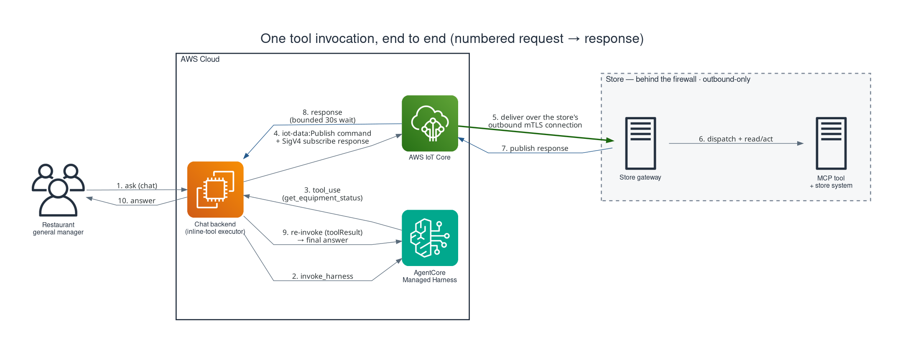
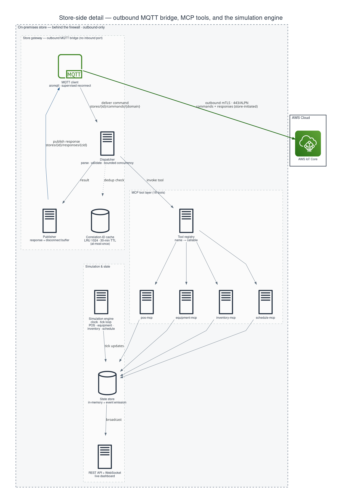
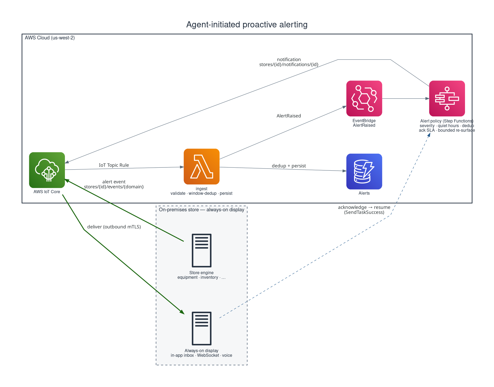

# Guidance for Building an AI Assistant for Restaurant General Managers on AWS

This Guidance demonstrates how to build a cloud-hosted AI assistant that helps restaurant general managers run their stores — answering operational questions such as _"How did we do on food cost this week?"_ or _"Which equipment needs maintenance?"_ — by letting the assistant securely invoke tools that run on systems inside each store. It addresses a problem common to any business that operates distributed physical locations: the operational data the AI needs (point-of-sale, kitchen equipment, inventory, and labor) lives behind a store firewall on systems that were never designed to accept inbound connections from the internet.

The pattern at the center of this Guidance is **secure remote tool invocation**. A managed AI agent in the cloud calls store tools that look, to the model, like ordinary local function calls. In reality each call is routed over an **outbound-only, mutually-authenticated** message channel to the target store, executed against the store's real systems, and returned — without ever opening an inbound port, provisioning a VPN, or standing up a DMZ at the store. The assistant serves managers, not diners, and the cloud never needs a direct network path into the store.

## Table of Contents

1. [Overview](#overview)
   - [Architecture overview](#architecture-overview)
   - [AWS services used](#aws-services-used)
   - [Cost](#cost)
2. [Architecture detail](#architecture-detail)
   - [Core principles](#core-principles)
   - [How it works: a tool invocation, end to end](#how-it-works-a-tool-invocation-end-to-end)
   - [Handling large tool results (the 128 KB limit)](#handling-large-tool-results-the-128-kb-limit)
   - [Store-side detail](#store-side-detail)
   - [Beyond request/response: proactive alerting and voice](#beyond-requestresponse-proactive-alerting-and-voice)
   - [A non-obvious pattern: not every tool should be the agent's to call](#a-non-obvious-pattern-not-every-tool-should-be-the-agents-to-call)
   - [Applicability beyond restaurants](#applicability-beyond-restaurants)
   - [Swappable options](#swappable-options)
3. [Prerequisites](#prerequisites)
   - [Operating system](#operating-system)
   - [Third-party tools](#third-party-tools)
   - [AWS account requirements](#aws-account-requirements)
   - [AWS CDK bootstrap](#aws-cdk-bootstrap)
   - [Supported Regions](#supported-regions)
4. [Automated Deployment](#automated-deployment)
5. [Manual Deployment](#manual-deployment)
6. [Deployment Validation](#deployment-validation)
7. [Running the Guidance](#running-the-guidance)
8. [Next Steps](#next-steps)
9. [Cleanup](#cleanup)
10. [FAQ, known issues, additional considerations, and limitations](#faq-known-issues-additional-considerations-and-limitations)
11. [Notices](#notices)
12. [References](#references)
13. [Authors](#authors)

## Overview

Quick-service and full-service restaurants share a common infrastructure reality. Critical operational data — real-time sales, equipment health, inventory levels, labor schedules — sits on local servers and devices inside each store, typically isolated behind NAT gateways and firewalls and reachable only from the store's internal network. Cloud-hosted AI agents, meanwhile, need that data to deliver useful operational intelligence.

Traditional ways of bridging this gap each introduce a cost the business should not have to pay:

- **VPN tunnels** require per-store configuration and ongoing maintenance, and they grant broad network access that violates least-privilege principles.
- **Inbound API endpoints** require the store to accept connections from the internet — something most restaurant network architectures explicitly prohibit.
- **Polling-based approaches** (queues, HTTP long-polling) add latency and do not naturally fit the bidirectional, request/response shape of agent tool invocation.

What the architecture needs instead is a transport that supports **persistent outbound connections initiated by the store**, **encryption in transit**, **graceful handling of intermittent connectivity**, and **per-location isolation that scales to hundreds of stores** without per-store infrastructure changes. The sections that follow show how to meet those requirements on AWS.

### Architecture overview

This Guidance uses a three-layer architecture — a **cloud agent layer**, a **transport layer**, and an **on-premises store layer**. The manager chats with the agent; the agent invokes store tools; the tools execute against the store's real systems and return their results over the same secure channel. Figure 1 shows the layers and the primary request path. Two implemented extensions build on the same IoT Core backbone — an agent-initiated **proactive alerting** layer and a **voice edge** (Amazon Nova Sonic speech-to-speech on the in-store display) — and are described under [Beyond request/response](#beyond-requestresponse-proactive-alerting-and-voice).

- **Cloud agent layer.** [Amazon Bedrock AgentCore](https://aws.amazon.com/bedrock/agentcore/) hosts a **Managed Harness** that runs the agent's reasoning loop — model selection, tool selection, tool execution, and response streaming — so the agent layer is *configuration* (model, system prompt, tools, memory, and execution limits) rather than a hand-written orchestration loop. A single harness exposes the store's tools as **inline functions**, and an attached **AgentCore Memory** resource provides same-session continuity. Managers reach the agent through a thin chat API: `POST /api/chat` returns `202 Accepted` with an `executionId`, and the client polls `GET /api/chat/result/{executionId}` for the answer.
- **Transport layer.** [AWS IoT Core](https://aws.amazon.com/iot-core/) provides a fully managed MQTT broker with built-in **mutual-TLS (X.509) device identity**. The cloud publishes commands to per-store, per-domain topics (`stores/{store_id}/commands/{domain}`); the store publishes responses to per-correlation-id topics (`stores/{store_id}/responses/{correlation_id}`). The store connects **outbound** to the IoT Core endpoint — by default on port 443 via the ALPN protocol `x-amzn-mqtt-ca` (reusing the outbound-HTTPS path, so no separate 8883 firewall rule is needed), or on port 8883 (see [Outbound-only connectivity](#1-outbound-only-connectivity) below) — and never accepts an inbound connection.
- **On-premises store layer.** A lightweight **store gateway** maintains the single outbound mTLS connection and routes incoming commands to four **Model Context Protocol (MCP)** servers — one each for point-of-sale, equipment, inventory, and scheduling. Each MCP server wraps the store's real systems behind a standard tool interface (18 tools in total). MCP is what decouples the cloud agent from store-specific hardware.

The cloud also runs an **integration layer** that turns an agent tool call into the IoT round-trip and correlates the response. This Guidance ships two correlation strategies, both described later: a direct **in-process round-trip** (the current production path), and an **event-driven relay** that adds a last-known-state cache for offline resilience.

> **Naming — "tool relay" vs AgentCore Gateway:** the cloud-side relay Lambdas of the event-driven relay path are deployed as `{domain}-tool-relay`. They are **not** AWS **AgentCore Gateway** — the managed primitive that exposes tools to an agent as an MCP server — which this Guidance evaluated and did not adopt (the production path uses inline tools on the in-process round-trip). The relay just publishes a tool call to IoT Core and correlates the response.

_Figure 1 — Reference architecture. A restaurant general manager chats with a cloud agent; the agent invokes store tools that execute behind the store's firewall, reached only over an outbound, mutually-authenticated connection. Editable source: [`diagrams/diagram1_architecture_overview.py`](docs/solution-guidance/diagrams/diagram1_architecture_overview.py) (mingrammer `diagrams`; re-render with `.venv/bin/python <script>`)._


### AWS services used

| AWS service | Role in this Guidance |
|---|---|
| [Amazon Bedrock AgentCore](https://aws.amazon.com/bedrock/agentcore/) | Managed Harness (text/analytics agent runtime) and Memory (session continuity) |
| [Amazon Bedrock](https://aws.amazon.com/bedrock/) | The foundation model that powers the text agent, and **Amazon Nova Sonic** (speech-to-speech) for the voice edge |
| [AWS IoT Core](https://aws.amazon.com/iot-core/) | Managed MQTT broker, mutual-TLS device identity, and the topic rules that route store responses (`stores/+/responses/+`) and store **alert events** (`stores/+/events/+`) |
| [AWS Lambda](https://aws.amazon.com/lambda/) | The tool-relay functions, the IoT response handler, the alert-ingest function, and the Web Push sender |
| [Amazon EventBridge](https://aws.amazon.com/eventbridge/) | The `AlertRaised` event bus that decouples alert capture from policy (proactive layer) |
| [AWS Step Functions](https://aws.amazon.com/step-functions/) | The proactive-alert policy workflow (severity, quiet hours, dedup, acknowledgment, bounded re-surface) |
| [Amazon DynamoDB](https://aws.amazon.com/dynamodb/) | `CommandResults` (correlation tracking), `StoreStateCache` (last-known-state), `Alerts` (proactive alerts, with TTL retention), and the Web Push subscription store |
| [AWS Secrets Manager](https://aws.amazon.com/secrets-manager/) | Per-store X.509 certificate material and the Web Push VAPID private key |
| [AWS Identity and Access Management (IAM)](https://aws.amazon.com/iam/) | Least-privilege execution roles and the per-store IoT policy (additively extended with an `events/*` publish grant) |
| [Amazon EC2](https://aws.amazon.com/ec2/), [Elastic Load Balancing (ALB)](https://aws.amazon.com/elasticloadbalancing/), [Amazon VPC](https://aws.amazon.com/vpc/) | Host the **store simulator** used for development and testing (see [Development and testing](#development-and-testing)); in a real deployment these are replaced by the store's own hardware |
| [Amazon CloudWatch](https://aws.amazon.com/cloudwatch/) | Logs, per-tool metrics, and Transaction Search for the agent and store gateway |

> The store simulator (Amazon EC2, ALB, Amazon VPC) is a **development and testing harness only — it is not part of the production solution**. In a real deployment the store side is provided by the store's own systems. See [Development and testing](#development-and-testing).

### Cost

_You are responsible for the cost of the AWS services used while running this Guidance. As of July 2026, the cost for running this Guidance with the default settings in the US West (Oregon) `us-west-2` Region is approximately **$92.00 per month** for a single-store development/demo deployment processing a light interactive workload (roughly 1,000 agent chat turns and a modest volume of store telemetry per month)._

_We recommend creating a [Budget](https://docs.aws.amazon.com/cost-management/latest/userguide/budgets-managing-costs.html) through [AWS Cost Explorer](https://aws.amazon.com/aws-cost-management/aws-cost-explorer/) to help manage costs. Prices are subject to change. For full details, refer to the pricing webpage for each AWS service used in this Guidance._

The following table provides a sample cost breakdown for deploying this Guidance with the default parameters in the US West (Oregon) `us-west-2` Region for one month. The largest and most variable component is Amazon Bedrock model inference (text agent plus Amazon Nova Sonic voice), which scales with the number and length of conversations.

| AWS service | Dimensions | Cost [USD/month] |
|---|---|---|
| Amazon EC2 | 1 × `t4g.medium` ARM64 instance (simulator), on-demand, 730 hrs | $24.53 |
| Amazon EBS | 30 GB `gp3` root volume | $2.40 |
| Elastic Load Balancing | 1 Application Load Balancer, low LCU usage | $18.00 |
| Amazon Bedrock (model inference) | ~1,000 chat turns + curated tool-use (an Anthropic Claude Sonnet-class model) | $20.00 |
| Amazon Bedrock Nova Sonic (voice) | Light speech-to-speech usage on the in-store display | $10.00 |
| Amazon Bedrock AgentCore | Managed Harness + Memory, light usage | $5.00 |
| AWS IoT Core | Connectivity + messaging + rules, single store, low volume | $2.00 |
| AWS Lambda | Tool-relay, response-handler, ingest, Web Push — low invocation count | $1.00 |
| Amazon DynamoDB | On-demand, 4 low-volume tables | $2.00 |
| AWS Step Functions | Standard workflow, few thousand state transitions | $1.00 |
| Amazon EventBridge | Custom event bus, low volume | $0.50 |
| AWS Secrets Manager | ~3 secrets (per-store cert, VAPID key) | $1.20 |
| Amazon CloudWatch | Logs, metrics, Transaction Search | $4.37 |
| **Total** | | **≈ $92.00** |

> These figures are approximate estimates for a single-store dev/demo deployment. Bedrock inference, Nova Sonic, and AgentCore costs are usage-dependent and will dominate at production chat volumes. Generate a definitive estimate with the [AWS Pricing Calculator](https://calculator.aws/) for your expected workload and Region, and upload the resulting PDF to BuilderSpace as part of submission.

## Architecture detail

This section explains the reusable core of the pattern and traces a request end to end. It is supplemental to the required deployment sections below; readers who only want to deploy can skip to [Prerequisites](#prerequisites).

### Core principles

Six principles give this architecture its security and operational properties. They are the reusable core of the pattern — the parts worth carrying into any deployment, restaurant or otherwise.

#### 1. Outbound-only connectivity

The store never accepts an inbound connection. Its gateway opens a single outbound, TLS-encrypted MQTT connection to AWS IoT Core; commands arrive over that same connection and responses leave over it. There is no inbound port, no VPN, and no DMZ at the store. This is the non-negotiable constraint of restaurant (and most retail) network security, and it shapes every other decision in the design. By default the store connects on **port 443** using the ALPN protocol name `x-amzn-mqtt-ca` (`MQTT_USE_ALPN=true`), reusing the outbound-HTTPS path virtually every managed network already permits — so no separate firewall rule is needed at all. The classic **port 8883** (`MQTT_BROKER_PORT=8883` + `MQTT_USE_ALPN=false`) remains available; its one distinction is that 8883 is not HTTPS, so a store firewall may need a single outbound allow rule for it. The reason 443/ALPN is not forced everywhere: a TLS-terminating or deep-packet-inspecting proxy that only forwards genuine HTTP on 443 can still block ALPN-tunneled MQTT, so 8883 vs. 443/ALPN stays a per-network choice.

#### 2. Per-store isolation

Each store is a distinct identity. With AWS IoT Core, every store is registered as an IoT *thing* with its own X.509 certificate, and a single shared **fleet policy** scopes each device to its own topic namespace using the `${iot:Connection.Thing.ThingName}` policy variable. A store can `Connect` only as its own client id, `Subscribe`/`Receive` only on `stores/{its-own-id}/commands/*`, and `Publish` only on `stores/{its-own-id}/responses/*`. One store cannot read or write another store's topics, and compromise of one store's certificate affects only that store. Because the policy is expressed with a thing-name variable rather than per-store literals, the same policy scales to hundreds of stores without a policy per location. (This requires `client_id == thing_name == store_id`, which the store gateway enforces.)

#### 3. Tool abstraction via MCP

The Model Context Protocol gives the cloud agent a stable, uniform tool interface regardless of what a store actually runs. Whether a system is a REST API, a serial port, or a proprietary controller, the store wraps it in an MCP server that exposes the same named tools. The tool name is the contract. A store can swap its POS vendor, and as long as the new MCP server exposes the same `get_daily_sales` tool, the cloud agent layer does not change. For operators running hundreds of locations with heterogeneous hardware across regions and acquisition histories, this decoupling is what makes the pattern viable at scale.

#### 4. Managed agent orchestration

The agent layer is the Amazon Bedrock AgentCore Managed Harness, which owns the reasoning loop. Rather than writing and maintaining an orchestration loop, you declare the agent in configuration — model, system prompt, the inline tool catalog, the attached memory resource, and execution limits — and the harness runs reasoning, tool selection, tool execution, and response streaming. The model, tools, and prompt become configuration changes rather than code rewrites, and per-step traces, logs, and metrics are emitted by the runtime. The store-side contract (MCP tools over MQTT) is independent of this choice, so the agent runtime can evolve without touching the store.

#### 5. Protocol-level resilience and graceful degradation

Restaurant networks are unreliable, and the design assumes it. MQTT **QoS 1** (at-least-once delivery) ensures a command is delivered even across a brief disconnect; because at-least-once can redeliver, the store gateway keeps a **correlation-ID dedup cache** (LRU + TTL) so that a redelivered command replays the cached response instead of re-executing a write — giving mutating tools an at-most-once effect. When a store is offline, IoT Core queues commands for a persistent session and delivers them on reconnect. For answers that must return even when a store is unreachable, successful reads are written through to a **`StoreStateCache`** table and a read that times out can fall back to that last-known value with an explicit staleness timestamp — by default on the event-driven path, and **optionally on the production in-process path** as well (default off). The manager gets a useful — if slightly stale — answer instead of a spinner.

#### 6. Security by default

Security is built into the transport and the IAM model, not added afterward:

- **Encryption in transit** — all store traffic is mutual-TLS (X.509), by default on port 443 via ALPN (or port 8883); the store and IoT Core each authenticate the other.
- **Least-privilege roles** — the harness execution role is scoped to exactly the Bedrock model it uses (the model is pinned, and the role's Bedrock resource scope is kept in lockstep with that pinned model id) and to the specific AgentCore Memory resource; it is deliberately *not* granted raw runtime-exec, gateway-invoke, `iam:*`, or any `Action: "*"`. Gateway and response-handler Lambdas are scoped to their specific tables and topics.
- **No sensitive data in the agent pipeline** — MCP tools return aggregated or operational data; payment card data and employee PII are never transmitted through the agent path, and tool results are sanitized (credential- and secret-looking keys are dropped, sizes bounded) before they reach the model.
- **The model is treated as an untrusted caller** — tool names come from a closed registry, and every tool parameter is validated against the schema advertised to the model (allowed keys only, declared type, bounded size, no control characters) before a call leaves the cloud. The **store a call is routed to is server-side session configuration and is never a model-supplied parameter**, so a prompt-injected model cannot aim a tool call at another tenant's store; the IoT publish grant is additionally scoped to that store's topics, so the platform denies a cross-tenant publish even if application logic is wrong.
- **Destructive tools require human confirmation** — see [A non-obvious pattern: not every tool should be the agent's to call](#a-non-obvious-pattern-not-every-tool-should-be-the-agents-to-call).
- **Every tool invocation is attributed** — the Cognito identity verified at the edge is stamped onto the origin request and recorded with each tool call (tool, store, outcome, and whether it mutates), so "who voided that order?" is answerable. Requested, granted, denied, and expired confirmations are recorded too. The identity is an opaque `sub`, never an email, and is used for attribution only — never authorization.
- **Tenant identity from the transport envelope** — store-originated events derive the store id from the authenticated IoT topic, never from a self-declared body field, preventing cross-tenant injection.

> ### ⚠️ Guardrails: required for production, deliberately not included here
>
> This Guidance does **not** attach an [Amazon Bedrock Guardrail](https://aws.amazon.com/bedrock/guardrails/) to the agent, and that is a scoping decision rather than a recommendation. The subject of this sample is the **brokered tool call** — reaching store systems over an outbound-only, mutually-authenticated channel with per-tenant isolation — so the controls it demonstrates are the ones on that path (closed tool registry, parameter allowlisting and type validation, server-side tenant routing, result sanitization, least-privilege IAM).
>
> Guardrails address a different layer: model **content** behavior. Because an agent with tool access can be steered by text it was never meant to obey — a manager pasting an supplier email, a review, or a tool result from a compromised store system — **a production implementation should apply Bedrock Guardrails, or equivalent controls drawn from your own organization's security standards**, in addition to the tool-layer controls shown here. Relevant Guardrail policies include the **prompt-attack** content filter, **denied topics**, and **sensitive-information filters** for PII.
>
> The configuration is deliberately left to the adopter: content categories, denied topics, and PII handling are organization- and jurisdiction-specific, so any value chosen here would be a placeholder masquerading as guidance. Treat the absence of a Guardrail in this repository as an omission to close, not as an endorsement. Consider also requiring explicit human confirmation before any **mutating** tool runs (this sample exposes `void_order`, timer, and alert-acknowledge tools), and testing the deployed agent against a prompt-injection suite.

> _Security guidance in this section reflects the controls implemented and validated in this project (see [References](#references)). An organizational security-policy (ARCC) reconciliation was not available during authoring; teams adopting this pattern should validate these controls against their own security guidance before production use._

### How it works: a tool invocation, end to end

Consider a manager asking, _"What's the walk-in cooler temperature?"_ Figure 3 traces the request on the current production path; the numbered steps below match the figure.

1. The manager sends the question to `POST /api/chat`. The backend returns `202 Accepted` with an `executionId` and runs the agent turn in the background; the client polls `GET /api/chat/result/{executionId}` for the result.
2. The backend invokes the harness for the session, passing the message and the inline tool catalog.
3. The harness reasons that it needs equipment data and streams a `tool_use` for `get_equipment_status` (stop reason `tool_use`).
4. The backend's **inline-tool executor** runs the tool. It first **subscribes** to the response topic `stores/{store_id}/responses/{correlation_id}` over a SigV4-authenticated MQTT-over-WebSocket connection, then **publishes** the command to `stores/{store_id}/commands/equipment` with QoS 1 via the connection-less `iot-data` data plane.
5. AWS IoT Core delivers the command to the store over the store's existing outbound mTLS link.
6. The store gateway checks its correlation-ID cache (idempotency), dispatches the command to the Equipment MCP server, and reads the **real equipment sensor**.
7. The store publishes the result to `stores/{store_id}/responses/{correlation_id}`.
8. The executor's subscription receives the response within the bounded wait, and sanitizes it into a tool result.
9. The backend re-invokes the harness with the `toolUse` and `toolResult` messages.
10. The harness formats the final answer (_"The walk-in cooler is at 38°F, within normal range."_). The next poll of `GET /api/chat/result` returns `succeeded` with the answer.

**If the store is slow or offline**, the executor's bounded timeout fires. By default it returns a structured error the model can reason about and relay to the manager, rather than hanging; **when the optional last-known-state cache is enabled (default off), it instead returns the last cached value for that read with a staleness timestamp.** Meanwhile IoT Core queues the command (persistent session) and delivers it when the store reconnects. The alternative **event-driven relay** path (described next) write-throughs reads to `StoreStateCache` unconditionally, providing the same last-known-state fallback for agents on that path.

_Figure 3 — A single tool invocation on the current production path (the in-process round-trip): the harness selects a tool, the backend executes it over an outbound IoT round-trip, and the answer returns to the manager. The timeout/offline behavior and the alternative event-driven relay (tool-relay Lambdas, IoT Topic Rule, iot-response-handler, DynamoDB) are described in the text below. Editable source: [`diagrams/diagram3_tool_invocation_flow.py`](docs/solution-guidance/diagrams/diagram3_tool_invocation_flow.py)._



### Handling large tool results (the 128 KB limit)

Both the command and the response ride MQTT, and AWS IoT Core caps each message at **128 KB** — a hard, non-adjustable service limit that applies to the whole message, not just the business payload. The design keeps the overwhelming majority of results well under it with two cheap steps before anything is sent. First, **compute at the MCP source and return the answer, not the raw rows**: the store already holds the data locally, so filtering, grouping, aggregating, and statistical work (outlier detection, trends, top-N) run for free, and the tool exposes a small **query algebra** (filter → group → aggregate → rank, plus a stats op) the agent fills in from the manager's question rather than a fixed catalog of question-specific tools. Second, **compress** the payload — gzip typically shrinks JSON exports and time-series 5–10×, dropping most of what remains under the limit. Results are sanitized and size-bounded before they leave the store (see [Security by default](#6-security-by-default)). Together these reduce *how often* a result is large; they do not guarantee every result is small.

For the residual cases that are genuinely large and irreducible — a raw transaction export, a long time-series, a batch of images — the store **chunks the response over the connection it already has**, splitting it into ordered segments that each fit under 128 KB and streaming them back-to-back on the same `stores/{id}/responses/{correlation_id}` topic; the cloud-side executor reassembles them into one tool result before the harness sees it. Each segment carries a correlation id, a sequence number, a total, and a checksum over the full payload, so the executor reassembles by sequence, discards duplicates, verifies integrity, and fails loudly with a structured error if a set is incomplete rather than returning a partial answer. Reassembly runs in the same long-lived in-process subscriber that already routes single-message responses — the chunks stream into one consumer that holds the buffer in memory, so there is no per-chunk compute to spin up — and a chunk cap sets an explicit ceiling on how large a streamed result can be. The full mechanics — envelope schema and the reassembler algorithm — are specified in [Chunking large tool results over AWS IoT Core](docs/solution-guidance/large-payload-chunking-design.md).

### Store-side detail

The store's on-premises footprint is intentionally small: a single gateway process and a set of MCP servers that can run on existing store hardware (a small server, a NUC, or even a Raspberry Pi). The gateway maintains the outbound mTLS connection, dispatches each incoming command to the right MCP server by tool name, applies the correlation-ID dedup cache, and publishes results back.

Behind the four MCP servers are the store's **real data sources** — in production, not a simulator:

- **POS MCP** wraps the store's point-of-sale system and terminals to expose sales, transactions, and order actions.
- **Equipment MCP** interfaces with kitchen equipment **sensors and controllers** for temperatures, status, timers, and alerts.
- **Inventory MCP** connects to the local **inventory database** for stock levels, usage, and waste.
- **Schedule MCP** reads the **scheduling system** for shifts and labor cost. The gateway can also draw on store **logs and event streams** as additional signal.

Two properties make this layer scale across a fleet. First, **MCP is the universal interface**: the cloud agent dispatches by tool name and is indifferent to whether the underlying system is a vendor REST API, a serial protocol, or a controller — so one store can differ from the next without changing the cloud. Second, **onboarding is per-store and self-contained**: provisioning a new store registers an IoT thing named for the store, attaches the shared thing-variable policy, issues an X.509 certificate, and stores the certificate bundle in AWS Secrets Manager (`restaurant-sim/iot/{store_id}/cert`) for the gateway to load at boot. Each store has an independent lifecycle, and the path to fleet-scale enrollment (just-in-time registration or fleet provisioning) is a natural extension of the same model.

_Figure 2 — Store-side detail. The store opens a single outbound, mutually-authenticated connection; commands arrive over that same link and responses leave over it. No inbound port is ever opened. In production the data sources are the store's real systems; in development they are the simulator (see "Development and testing"). Editable source: [`diagrams/diagram2_store_side_detail.py`](docs/solution-guidance/diagrams/diagram2_store_side_detail.py)._



### Beyond request/response: proactive alerting and voice

The core pattern above is **reactive** — the manager asks, the agent answers. Two implemented extensions build on the same IoT Core backbone to make the assistant **proactive** (it reaches out when something needs attention) and **spoken** (it talks, on an in-store display). Both are deployed and validated in the non-prod environment; see [ADR-006](docs/adr/ADR-006-proactive-alerting-layer.md) and [ADR-005](docs/adr/ADR-005-nova-sonic-voice-interface.md) for the decisions and the spec history.

#### Agent-initiated proactive alerting

The store→cloud path was originally response-only — nothing left the store unless the cloud asked for it. The proactive layer adds a store→cloud **event** path so the assistant can surface a problem (an equipment failure, a low-stock condition) without being asked. It reuses the exact `IoT Topic Rule → Lambda` shape already proven for tool responses, so it introduces **no new connectivity model** and preserves the outbound-only, per-store-isolation security posture.

1. **Store emits an event.** The store publishes an alert envelope to `stores/{id}/events/{domain}` (QoS 1) over its **existing outbound mTLS connection**. The shared IoT fleet policy gains one **additive** `${iot:Connection.Thing.ThingName}`-scoped `events/*` publish grant, so per-store isolation holds and an alert is provably from the device that owns the topic.
2. **Ingest, dedup, persist, emit.** An **IoT Topic Rule** (`stores/+/events/+`) invokes an **ingest Lambda** that deduplicates with a deterministic, time-bucketed key and a single atomic conditional write — idempotent under QoS-1 redelivery and a flapping sensor — persists the alert to an **`Alerts` DynamoDB table** (TTL retention), and emits an `AlertRaised` event to **Amazon EventBridge**.
3. **Policy.** EventBridge triggers an **AWS Step Functions** (Standard) workflow that owns alert policy: **severity gating** (warning and above notify; info is inbox-only), **quiet hours** with a critical override, dedup/debounce within a ~15-minute window, **acknowledgment** tracking via `waitForTaskToken`, and — on no-ack within an SLA (critical 5 min / warning 30 min) — **bounded re-surfacing on the same display**, then expiry.
4. **Deliver to the display.** The orchestrator delivers the notification **into a single, always-on in-store display** via a cloud→store `notifications` relay that feeds the display's existing **WebSocket** and an **in-app alert inbox** (the durable floor, so an alert is never silently lost). Acknowledging from the display calls `SendTaskSuccess` to resume the workflow over the same IoT path.

There is **no telephony and no on-call escalation chain** — delivery terminates at the in-store display (a deliberate scope decision; see the proposal deviations below). Because the ingest validates the event **envelope** rather than the domain, adding a new alert source is purely a store-side change: inventory low-stock alerts were added by having the store emit a well-formed envelope, with **zero cloud change**.

_Figure 4 — Agent-initiated proactive alerting. A store alarm flows store → IoT `events` → ingest (dedup + persist) → `Alerts` + EventBridge → a Step Functions policy → a `notifications` relay back to the always-on in-store display (in-app inbox + WebSocket; spoken via the voice edge). Acknowledgment resumes the workflow; an unacknowledged alert re-surfaces on the same display up to a bound, then expires. Editable source: [`diagrams/diagram4_proactive_alerting.py`](docs/solution-guidance/diagrams/diagram4_proactive_alerting.py)._



#### Voice edge (Amazon Nova Sonic)

The in-store display also offers a **spoken** interface. A speech-to-speech session uses **Amazon Nova Sonic** (`amazon.nova-2-sonic-v1:0`) over Bedrock's bidirectional-stream API for natural, low-latency, barge-in two-way voice. A **server-side voice broker** holds the Bedrock stream — so **no AWS credentials ever reach the browser**; the browser streams microphone audio to the broker over a WebSocket, and Nova Sonic streams audio back. Nova Sonic **owns its own tool-use**, calling store tools over the same in-process IoT round-trip, and is offered a small **curated tool set** (real-time tool selection degrades when too many tools are presented). The text `/api/chat` path stays on the AgentCore Managed Harness — [ADR-005](docs/adr/ADR-005-nova-sonic-voice-interface.md) **narrows** ADR-003 to "text and analytics," it does not supersede it.

Two integrations tie the voice edge to the rest of the system:

- **Spoken proactive delivery.** A proactive alert surfaced on the display (above) is **spoken** by a Nova Sonic session, and the manager can converse and act — acknowledge, ask follow-ups, set a timer — in that same session, with tool calls flowing back through the IoT round-trip.
- **Web Push re-engagement.** When the display's tab is backgrounded, a consent-gated **Web Push** notification re-engages it. The VAPID **private key is held in AWS Secrets Manager** and is never bundled or sent to the browser (only the public key reaches the client); the in-app inbox remains the floor when consent is absent.

Security and operational notes for this edge: audio is streamed **ephemerally and is not persisted**, and there is **no transcript retention** by default; the Bedrock grant is scoped to the model ARN (three cross-region invoke actions are required because Nova Sonic inference fans out across regions); and the voice runtime requires **Python 3.12** (a Nova Sonic SDK requirement). The only Python path to the bidirectional API is the **experimental, pre-1.0 `aws-sdk-bedrock-runtime` SDK** — a maturity/dependency caveat carried into the build.

### A non-obvious pattern: not every tool should be the agent's to call

Most of the security work in an agent that reaches real systems goes into making the *channel* safe — mutual TLS, per-tenant isolation, least-privilege IAM, parameter validation. Those controls constrain **how** a call is made. They say nothing about **whether it should have been made at all**.

That gap matters because of how prompt injection actually reaches a restaurant manager. It does not arrive as an attacker typing into the chat box; it arrives as text the manager legitimately pastes — a supplier email, a customer review, a photographed delivery note — or as a tool result from a store system that has itself been compromised. The manager is not the adversary, and the model is not malfunctioning: it is doing what the text in its context asked. Every channel control still passes.

So this Guidance draws a line that is easy to miss when designing an agent: **a tool that destroys or is awkward to reverse is not the agent's to call unilaterally.** `void_order` (destroys a sale record) and `log_waste` (writes an inventory adjustment) suspend mid-turn and wait for a human:

1. The model selects the tool; the backend **validates** the parameters as usual.
2. Instead of publishing to the store, the turn **ends** and `GET /api/chat/result/{id}` returns a fourth state, `confirmation_required`, carrying the tool name and the *validated* parameters.
3. The display renders a confirm/decline prompt. The manager approves **exactly what will run** — not something re-derived from the conversation afterwards.
4. `POST /api/chat/confirm` resumes the turn. Approval executes the tool once; declining returns a `toolResult` telling the model the manager said no, so it can respond conversationally rather than appearing to fail.

Four properties make this a control rather than a speed bump, and each is the result of a decision worth copying:

- **The decision is made outside the model.** The model cannot satisfy, skip, or synthesise a confirmation, and it is never asked whether it is sure. Asking a model to self-approve is not a control.
- **Confirmations are single-use and expire.** The pending record is consumed before the resuming work starts, so a double-click cannot void twice; and the window (90 seconds) is deliberately shorter than the client's polling budget, so an abandoned action cannot be completed later from a stale browser tab.
- **Expiry is never silent.** The worst available outcome is a manager who believes something happened that did not, so an expired confirmation reports that nothing was changed.
- **The scope is deliberately narrow.** Only the destructive tools are gated. The other five mutating tools — timers, clock-in/out, alert acknowledgement — are reversible and *frequent*, and gating them would mean a manager confirming a fryer timer twenty times a shift. A prompt that is always approved reflexively is worse than no prompt: it trains the reflex that makes the `void_order` prompt ineffective too. Where a tool's *semantics* can be checked instead, they are checked at the store, which is the only layer that knows what a plausible value is — the timer tool rejects a non-positive duration there.

> **For a production implementation, make this decision for _every_ tool, not just the destructive ones.** This Guidance gates two tools because that is the right trade-off for *this* tool set; it is a worked example, not a recommendation to copy the list. Which of your tools may run on the model's word alone is a judgement that depends on your own requirements, risk tolerance, regulatory obligations, and organizational security policies — how reversible each action is, what it costs when it is wrong, who is accountable for it, and whether an operator will realistically read the tenth confirmation of the day. Walk your tool catalogue and decide deliberately for each entry; the outcome may reasonably be stricter than this sample (confirm every mutation, or require a second approver for some) or looser. What matters is that the decision is explicit and recorded, rather than defaulting to "the agent can call anything it has been given."


### Applicability beyond restaurants

Although this Guidance is framed around restaurants, the pattern applies to any industry that operates distributed physical locations whose systems sit behind a local firewall:

- **Retail** — store-level inventory, point-of-sale, and loss-prevention systems behind corporate firewalls.
- **Consumer packaged goods (CPG)** — production-line controllers, quality sensors, and batch-management systems on the factory floor.
- **Hospitality** — property-management systems, HVAC controllers, and guest-service platforms across a portfolio of properties.
- **Healthcare and field services** — clinic-management systems, diagnostic equipment, and remote service terminals operating behind facility-level firewalls.

The core remains the same: an MQTT transport for secure, outbound-only connectivity; MCP for a standardized tool interface across diverse hardware; and a managed agent for domain-specific reasoning. What changes between industries is the set of MCP servers and the agent's domain knowledge — not the security model or the transport.

### Swappable options

A strength of this pattern is that the store-side and cloud-side contracts stay the same while individual building blocks are swapped to fit an organization's requirements. Three axes are worth calling out.

#### Transport: AWS IoT Core (primary) or Amazon MQ

This Guidance uses **AWS IoT Core** as the transport because it brings per-device X.509 identity, automatic per-device policy scoping, message queuing for offline devices, and a rules engine for routing — a close match to a real fleet of stores. **[Amazon MQ](https://aws.amazon.com/amazon-mq/)** with the ActiveMQ engine is a valid alternative when an organization already operates ActiveMQ or wants a general-purpose multi-protocol broker inside its VPC; note that Amazon MQ authenticates MQTT clients with a username and password over TLS (it does not support TLS client-certificate authentication), so the per-device-certificate identity model is specific to IoT Core. The core MQTT transport pattern — outbound-only, QoS 1, per-store topic namespaces — is identical for both; only the connection and authentication configuration changes.

#### Agent runtime: Managed Harness (primary), durable functions, or container runtime

The agent layer here is the **AgentCore Managed Harness**, which removes the burden of hand-writing and operating the reasoning loop. Equivalent results are achievable with a self-hosted loop on **[AWS Lambda](https://aws.amazon.com/lambda/) durable functions** (scale-to-zero, native suspend/resume for long tool calls) or on a **container runtime** such as Amazon Bedrock AgentCore on AWS Fargate. The trade-off is managed-simplicity versus control of the loop; because the store-side MCP contract is independent of the runtime, this choice can change without touching the store. (This project ran all three over its lifetime; the durable-function layer was decommissioned in spec 022 Task 6 once the harness reached production parity, so the harness is now the only agent runtime in the deployment.)

#### Correlation and offline state: in-process round-trip or event-driven relay

> These two strategies are called **Correlation A** (in-process round-trip) and
> **Correlation B** (event-driven relay) in this repository's specs, findings and ADRs. The
> mechanism-based names are used here because the lettered ones encode nothing a reader can
> act on.

The current production path is the **in-process round-trip**: the inline-tool executor subscribes to the response topic, publishes the command, and waits on a bounded timeout. It is the simplest model and keeps the full tool call within a single agent turn. The executor **pools** its MQTT-over-WebSocket connection (and reuses the `iot-data` client) across calls rather than reconnecting per call, and can **optionally** serve last-known state from `StoreStateCache` on a read timeout (write-through on success + a staleness marker; default off) — bringing the event-driven relay's offline resilience to the in-process path. These, plus per-tool CloudWatch metrics and an optional context-aware tool-catalog filter, are tool-layer refinements tuned against AWS Well-Architected AGENTPERF06.

The **event-driven relay** is the alternative (also deployed in this project): an [AWS Lambda](https://aws.amazon.com/lambda/) tool relay publishes the command and writes a pending record to an [Amazon DynamoDB](https://aws.amazon.com/dynamodb/) `CommandResults` table; the store's response triggers an **IoT Topic Rule** (`stores/+/responses/+`) that invokes a response-handler Lambda, which resolves the correlation and **writes successful reads through to a `StoreStateCache` table**. This decouples publish from response, fits a fan-out across many domains, and enables the **last-known-state fallback** with a staleness timestamp when a store is offline. For organizations that prefer a managed last-known-state primitive, AWS IoT Core's **Device Shadow** offers a comparable capability at the device layer instead of the application-level cache.

## Prerequisites

### Operating system

These deployment instructions are optimized to best work on **Amazon Linux 2023**. Deployment in another OS (macOS, Ubuntu/Debian, Windows with WSL2) may require additional steps. The following packages are not installed by default and are required:

| Package | Version | Purpose | Install (Amazon Linux 2023) |
|---|---|---|---|
| Python | 3.12+ | CDK synth/deploy, tests, provisioning scripts, and the voice runtime (Nova Sonic SDK requires ≥ 3.12) | `sudo dnf install -y python3.12 python3.12-pip` |
| Node.js | 18+ | Frontend dashboard build (Vite) | `sudo dnf install -y nodejs` |
| AWS CLI | v2 | Credentials, deployment validation, and cleanup | Preinstalled on Amazon Linux 2023 |
| AWS CDK | 2.x | Infrastructure as code (`npm install -g aws-cdk`) | `npm install -g aws-cdk` |
| Git | any recent | Clone the repository | `sudo dnf install -y git` |
| Docker (or Finch) | any recent | Bundling Lambda dependencies with native extensions for ARM64 | `sudo dnf install -y docker` |

> **Lambda bundling note.** Lambda functions target **arm64**. On an x86_64 host, bundling dependencies with native extensions for ARM64 requires a one-time QEMU registration per host boot: `docker run --rm --privileged multiarch/qemu-user-static --reset -p yes`. Pure-Python dependencies do not need this. See an internal design record.

### Third-party tools

- **[boto3](https://boto3.amazonaws.com/v1/documentation/api/latest/index.html) ≥ 1.43.30** — required for the AgentCore Managed Harness GA control-plane and invoke APIs (pinned in each stack's `requirements-dev.txt`).
- **[AWS CDK Toolkit](https://docs.aws.amazon.com/cdk/v2/guide/cli.html)** — installed via `npm` as noted above.

### AWS account requirements

This deployment requires:

- **Amazon Bedrock model access** enabled in your account and Region for the text model the harness pins — an **Anthropic Claude Sonnet-class** model — and, for the voice edge, **Amazon Nova Sonic** (`amazon.nova-2-sonic-v1:0`, a hard requirement: it is the speech-to-speech engine). The exact text-model id is deliberately not repeated here; it lives in one place, `bedrockModelId` in [`infra/harness-agent/cdk.json`](infra/harness-agent/cdk.json), because that value also scopes the harness execution role's Bedrock permissions and the two must not drift. Request access in the Amazon Bedrock console under **Model access**.
- **Amazon Bedrock AgentCore** available in your Region (this Guidance uses `us-west-2`).
- **CloudWatch Transaction Search** enabled once per account so the harness's per-step tool-invocation traces are queryable (one-time operator action in the CloudWatch console).
- IAM permissions sufficient to deploy the CDK stacks (VPC, EC2, ALB, IoT Core, Lambda, DynamoDB, Step Functions, EventBridge, Secrets Manager, IAM roles).

### AWS CDK bootstrap

This Guidance uses AWS CDK. If you are using AWS CDK for the first time in this account/Region, bootstrap it once before deploying:

```bash
cdk bootstrap aws://<account-id>/us-west-2
```

### Supported Regions

This Guidance is developed and validated in **US West (Oregon) `us-west-2`**. It depends on services with Region-specific availability — Amazon Bedrock AgentCore, the pinned Bedrock foundation model, and Amazon Nova Sonic. Deploy in a Region where all three are available; `us-west-2` is recommended. Amazon Nova Sonic inference fans out across Regions, which the Bedrock IAM grant accounts for with a Region-wildcard model ARN.

## Automated Deployment

This section provides the quickest path to deploy the Guidance using an automated script.

> **Note:** The one-click deploy script (`scripts/deploy.sh`) has not been generated yet. Generate it using the **deploy-scripts** automation of the Guidance Factory power to complete this section, then it will orchestrate the multi-stack CDK deployment (dependency installation, CDK bootstrap check, and the stacks in the order shown in [Manual Deployment](#manual-deployment)) and validate the result.

Once generated, usage is:

```bash
# Clone the repository
git clone <repository-url>
cd restaurant-manager-agent

# Make the script executable and run it
chmod +x scripts/deploy.sh
./scripts/deploy.sh
```

**Environment:**
- Designed for AWS CodeBuild environments running Amazon Linux 2023.
- Can also be run on Amazon Linux 2023 EC2 instances or local environments.
- Requires the AWS CLI configured with appropriate credentials and the [Prerequisites](#prerequisites) installed.

**Note:** For a detailed understanding of each deployment step, see the [Manual Deployment](#manual-deployment) section below.

## Manual Deployment

This section provides step-by-step instructions for manual deployment. Use it to understand each step in detail or to customize the deployment. The stacks are independent CDK apps and are deployed in dependency order. All stacks deploy to **`us-west-2`**.

1. **Clone the repository.**

   ```bash
   git clone <repository-url>
   cd restaurant-manager-agent
   ```

2. **Bootstrap CDK** (first-time users only — see [Prerequisites](#aws-cdk-bootstrap)).

   ```bash
   cdk bootstrap aws://<account-id>/us-west-2
   ```

3. **Deploy the store transport (AWS IoT Core).** Creates the `iot-response-handler` Lambda, the IoT Topic Rule on `stores/+/responses/+`, the shared fleet policy, and per-store provisioning tooling.

   ```bash
   cd infra/iot-core-broker
   python3.12 -m venv .venv
   .venv/bin/pip install -r requirements-dev.txt
   PATH=.venv/bin:$PATH cdk deploy
   cd ../..
   ```

4. **Provision a store identity.** Registers an IoT thing named for the store, attaches the shared thing-variable policy, issues an X.509 certificate, and stores the bundle in AWS Secrets Manager (`restaurant-sim/iot/{store_id}/cert`).

   ```bash
   cd infra/iot-core-broker
   .venv/bin/python provision/provision_store.py --store-id sim-store-001
   cd ../..
   ```

5. **Deploy the cloud tool relay (relay Lambdas + DynamoDB).** Creates the four `{pos,equipment,inventory,schedule}-tool-relay` Lambdas and the `CommandResults` and `StoreStateCache` tables.

   ```bash
   cd infra/cloud-tool-relay
   python3.12 -m venv .venv
   .venv/bin/pip install -r requirements-dev.txt
   PATH=.venv/bin:$PATH cdk deploy
   cd ../..
   ```

6. **Deploy the agent layer (AgentCore Managed Harness).** Creates the least-privilege harness execution role, then provisions the harness itself via the control-plane script (the harness has no stable CloudFormation construct at GA).

   ```bash
   cd infra/harness-agent
   python3.12 -m venv .venv
   .venv/bin/pip install -r requirements-dev.txt
   PATH=.venv/bin:$PATH cdk deploy
   # Note the HarnessExecutionRoleArn output, then:
   .venv/bin/python provision/provision_harness.py --role-arn <HarnessExecutionRoleArn>
   cd ../..
   ```

7. **Deploy the proactive alerting layer.** Creates the `Alerts` table, the ingest Lambda + IoT Topic Rule on `stores/+/events/+`, the `AlertRaised` EventBridge bus, and the Step Functions policy workflow.

   ```bash
   cd infra/proactive-alerting
   python3.12 -m venv .venv
   .venv/bin/pip install -r requirements-dev.txt
   PATH=.venv/bin:$PATH cdk deploy
   cd ../..
   ```

8. **(Optional) Deploy the Web Push re-engagement layer** for the voice/proactive display.

   ```bash
   cd infra/web-push
   python3.12 -m venv .venv
   .venv/bin/pip install -r requirements-dev.txt
   PATH=.venv/bin:$PATH cdk deploy
   cd ../..
   ```

9. **Deploy the store simulator (development/testing only).** Stands up a VPC, one ARM64 EC2 instance running the simulator, and an **internal** Application Load Balancer fronted by **Amazon CloudFront** with Cognito edge auth (spec 029). On success the stack prints the CloudFront URL. See the simulator-access note below for the one-time two-phase bootstrap.

   ```bash
   cd infra/simulator-ec2-alb
   python3.12 -m venv .venv
   .venv/bin/pip install -r requirements-dev.txt
   PATH=.venv/bin:$PATH cdk deploy SimulatorEc2AlbStack
   cd ../..
   ```

   > **This is the only multi-stack app.** CDK adds a `us-east-1` support stack for the Lambda@Edge authenticator, so `cdk deploy` / `diff` / `destroy` must name `SimulatorEc2AlbStack`; a bare command fails with *"Since this app includes more than a single stack..."*. The other five stacks are single-stack and need no argument.

   > In a real deployment, replace the simulator with the store's own systems running the store gateway and MCP servers (see [Development and testing](#development-and-testing)).

   > **Simulator access (spec 029 — CloudFront edge auth).** The simulator's ALB is **internal** and fronted by **Amazon CloudFront** with **Cognito login enforced at the edge** (Lambda@Edge `cognito-at-edge`, free `*.cloudfront.net` cert — no domain / Route 53 / ACM, superseding spec 007). The first rollout is a **two-phase bootstrap**: run `lambdas/edge-auth/bundle.sh`, then `cdk deploy SimulatorEc2AlbStack` (creates Cognito + the distribution), then redeploy with the Cognito IDs in `edgeCognito*` context to associate the edge authenticator (`us-east-1` must also be CDK-bootstrapped for the Lambda@Edge support stack; routine deploys thereafter need no `-c`). Access the dashboard at the **`CloudFrontUrl`** output (`https://<CloudFrontDomainName>/`) — unauthenticated visitors are redirected to the Cognito Hosted UI. See [`infra/simulator-ec2-alb/README.md`](infra/simulator-ec2-alb/README.md) and an internal design record for the two-phase deploy, smoke tests, and destroy.

Each stack's own README (`infra/<stack>/README.md`) documents its context flags, smoke tests, and outputs.

## Deployment Validation

After deployment, validate each layer:

1. **CloudFormation stacks.** Confirm every stack reached `CREATE_COMPLETE`/`UPDATE_COMPLETE`:

   ```bash
   aws cloudformation describe-stacks --region us-west-2 \
     --query "Stacks[].{Name:StackName,Status:StackStatus}" --output table
   ```

2. **Simulator dashboard.** Retrieve the CloudFront URL and open the dashboard:

   ```bash
   aws cloudformation describe-stacks --region us-west-2 \
     --stack-name SimulatorEc2AlbStack \
     --query "Stacks[0].Outputs[?OutputKey=='CloudFrontDomainName'].OutputValue" --output text
   ```

   Browse to `https://<CloudFrontDomainName>/` — unauthenticated visitors are redirected to the Cognito Hosted UI; after login the dashboard shows live orders, equipment temperatures, inventory, and schedule. (The internal ALB has no public entry point; `/api/health` is reachable through CloudFront after login.)

3. **Store connectivity.** Confirm the simulator's gateway is connected to IoT Core. On the simulator EC2 instance (over SSM), the application log shows the MQTT connect line:

   ```bash
   sudo grep -iE "mqtt connected|port=|alpn=" /var/log/restaurant-sim.log
   ```

   > The simulator logs to `/var/log/restaurant-sim.log`, not journald — `journalctl -u restaurant-sim` shows only unit-lifecycle lines.

4. **Agent harness.** Confirm the harness is `READY`:

   ```bash
   aws bedrock-agentcore-control list-harnesses --region us-west-2
   ```

5. **End-to-end tool call.** From the dashboard chat (or `POST /api/chat`), ask _"What's the walk-in cooler temperature?"_ and confirm a grounded answer returns after polling `GET /api/chat/result/{executionId}` — proof the full cloud → IoT → store → cloud round-trip works.

## Running the Guidance

Once deployed and validated, the Guidance is driven through the chat interface fronting the cloud agent.

**Inputs:** natural-language operational questions from a store manager, for example:

- _"How did we do on sales today?"_
- _"Which equipment needs attention?"_
- _"Are we going to run out of anything this weekend?"_
- _"Set a 10-minute timer on the fryer."_

**Commands.** Use the dashboard chat box at `https://<CloudFrontDomainName>/` after logging in via the Cognito Hosted UI. CloudFront enforces Cognito auth on every request (spec 029), so `/api/chat` is reachable only with a valid Cognito session — use the in-browser dashboard for the demo. The API shape (behind the login) is:

```bash
# Start a chat turn (returns 202 + executionId)
curl -s -X POST https://<CloudFrontDomainName>/api/chat \
  -H 'Content-Type: application/json' \
  -d '{"session_id":"demo-1","message":"Which equipment needs attention?"}'

# Poll for the result
curl -s "https://<CloudFrontDomainName>/api/chat/result/<executionId>?session_id=demo-1"
```

**Expected output.** The result poll returns `succeeded` with a grounded natural-language answer synthesized from live store data, for example: _"The walk-in cooler is at 38°F (normal). The fryer is reading 12°F above its setpoint and has an open maintenance alert — you may want to check it."_ The answer reflects real tool calls executed against the store systems over the secure IoT round-trip.

To exercise the proactive path, inject an equipment failure from the dashboard (`POST /api/sim/inject-event`) and confirm the unsolicited alert appears in the display's in-app inbox and, if the voice edge is enabled, is spoken.

## Next Steps

Customize and extend the Guidance to fit your environment:

- **Add or swap MCP tools.** Extend a domain MCP server (or add a fifth) to expose new store systems. As long as the tool name is stable, the cloud agent layer needs no change (see [Tool abstraction via MCP](#3-tool-abstraction-via-mcp)).
- **Tune the agent.** Change the model, system prompt, curated voice tool set, or execution limits — these are harness configuration, not code (`infra/harness-agent`). Keep the model id and the role's Bedrock scope in lockstep.
- **Choose your transport and correlation strategy.** Swap AWS IoT Core for Amazon MQ, or move from the in-process round-trip to the event-driven relay for offline resilience (see [Swappable options](#swappable-options)).
- **Scale the fleet.** Move from per-store provisioning to IoT just-in-time registration or fleet provisioning; the shared thing-variable fleet policy already scales to many stores without per-store policy changes.
- **Adapt to another industry.** The pattern applies to any business with distributed physical locations behind a local firewall — retail, CPG manufacturing, hospitality, healthcare, and field services. What changes is the set of MCP servers and the agent's domain knowledge, not the security model or transport.
- **Tighten security for your organization.** Two things to close before production. First, **apply [Amazon Bedrock Guardrails](https://aws.amazon.com/bedrock/guardrails/) or equivalent controls from your own security standards** — this Guidance deliberately ships without one (see [Guardrails: required for production](#️-guardrails-required-for-production-deliberately-not-included-here)), because the configuration is organization- and jurisdiction-specific; the prompt-attack filter, denied topics, and sensitive-information filters are the relevant policies, and you should consider requiring human confirmation before any mutating tool runs. Second, validate the implemented controls against your own security guidance (ARCC or equivalent).

## Cleanup

Delete the deployed resources in reverse dependency order to avoid CloudFormation export-in-use errors. For each stack, run `cdk destroy` from its directory (with its venv on the `PATH`):

```bash
cd infra/simulator-ec2-alb && PATH=.venv/bin:$PATH cdk destroy SimulatorEc2AlbStack && cd ../..
cd infra/web-push          && PATH=.venv/bin:$PATH cdk destroy && cd ../..
cd infra/proactive-alerting && PATH=.venv/bin:$PATH cdk destroy && cd ../..
cd infra/cloud-tool-relay   && PATH=.venv/bin:$PATH cdk destroy && cd ../..
```

Tear down the harness (control-plane resource) before destroying its role stack:

```bash
cd infra/harness-agent
.venv/bin/python provision/provision_harness.py --teardown
PATH=.venv/bin:$PATH cdk destroy
cd ../..

cd infra/iot-core-broker && PATH=.venv/bin:$PATH cdk destroy && cd ../..
```

**Manual deletion required** (not removed by `cdk destroy`):

- **AWS Secrets Manager** per-store certificate secrets (`restaurant-sim/iot/{store_id}/cert`) and the Web Push VAPID secret. Delete them explicitly, or they remain (billed) until their recovery window elapses:

  ```bash
  aws secretsmanager delete-secret --region us-west-2 \
    --secret-id restaurant-sim/iot/sim-store-001/cert --force-delete-without-recovery
  ```

- **IoT things, certificates, and policies** created by the provisioning script. Detach and delete the certificate, then delete the thing, for each provisioned store.
- **DynamoDB tables** with `RETAIN` removal policies (if configured) and any **CloudWatch log groups** you no longer need.

## FAQ, known issues, additional considerations, and limitations

**Additional considerations**

- **The store simulator is a development/testing harness only — it is not part of the production solution.** In a real deployment, everything inside the store boundary in Figures 1, 2, and 4 (POS, equipment sensors/controllers, inventory database, scheduling system, logs/event streams) is the store's own systems. Wherever this Guidance shows in-store data sources, substitute those real systems for the simulator.
- **This Guidance creates an Amazon CloudFront distribution in front of an internal Application Load Balancer** for the simulator dashboard, and the `t4g.medium` EC2 instance is billed per hour regardless of usage. Costs accrue while the simulator stack is deployed.
- **Amazon Bedrock inference is usage-metered** — the text agent, Nova Sonic voice, and AgentCore harness costs scale with conversation volume and will dominate at production usage.
- **The voice edge uses an experimental, pre-1.0 SDK** (`aws-sdk-bedrock-runtime`) for the Bedrock bidirectional-stream API — a maturity/dependency caveat to weigh for production.
- **Security controls have not been reconciled against an organizational security policy (ARCC).** Validate against your own guidance before production use.

**Known issues**

- Real-time voice tool-selection degrades when too many tools are offered; keep the voice tool set small and curated (~≤8). The full tool set remains on the text path.
- On x86_64 build hosts, ARM64 Lambda bundling requires the one-time QEMU registration noted in [Prerequisites](#operating-system).

For any feedback, questions, or suggestions, please use the issues tab under this repository.

## Notices

*Customers are responsible for making their own independent assessment of the information in this Guidance. This Guidance: (a) is for informational purposes only, (b) represents AWS current product offerings and practices, which are subject to change without notice, and (c) does not create any commitments or assurances from AWS and its affiliates, suppliers or licensors. AWS products or services are provided "as is" without warranties, representations, or conditions of any kind, whether express or implied. AWS responsibilities and liabilities to its customers are controlled by AWS agreements, and this Guidance is not part of, nor does it modify, any agreement between AWS and its customers.*

## References

- [`ABSTRACT.md`](ABSTRACT.md) — project abstract.
- [`setup-instructions.md`](setup-instructions.md) — setup, deployment stacks, and run instructions for the simulator and the cloud stacks.
- Architecture Decision Records:
  - [ADR-001 — Durable Lambda for agents](docs/adr/ADR-001-durable-lambda-for-agents.md)
  - [ADR-002 — Two-tier agent architecture](docs/adr/ADR-002-two-tier-agent-architecture.md)
  - [ADR-003 — AgentCore Managed Harness](docs/adr/ADR-003-agentcore-managed-harness.md) (current text/analytics agent layer)
  - [ADR-004 — IoT Core broker migration](docs/adr/ADR-004-iot-core-broker-migration.md) (current transport)
  - [ADR-005 — Nova Sonic voice interface](docs/adr/ADR-005-nova-sonic-voice-interface.md) (current voice edge)
  - [ADR-006 — Proactive alerting layer](docs/adr/ADR-006-proactive-alerting-layer.md) (current proactive layer)
- [`voice-interface-alternate-pattern.md`](docs/solution-guidance/voice-interface-alternate-pattern.md) — the **reactive-only cascade** (Amazon Transcribe + Polly) that was **demoted to a documented fallback**; the implemented voice edge uses Amazon Nova Sonic ([ADR-005](docs/adr/ADR-005-nova-sonic-voice-interface.md)) instead.
- [`voice-and-proactive-architecture-proposal.md`](docs/solution-guidance/voice-and-proactive-architecture-proposal.md) — the **decision proposal** behind this work. Its proactive **Phase 0** ([ADR-006](docs/adr/ADR-006-proactive-alerting-layer.md), spec 023) and Nova Sonic **voice Phase 1** ([ADR-005](docs/adr/ADR-005-nova-sonic-voice-interface.md), spec 025) are **now implemented and validated in non-prod** — with two notable deviations from the proposal: there is **no on-call escalation or Schedule-domain contact resolution** (delivery terminates at a single always-on in-store display with bounded re-surfacing), and the per-person contact directory was therefore dropped.

## Development and testing

You cannot develop and test a cloud-to-store agent pipeline against physical restaurant hardware during early development. To close that gap, this project includes a **restaurant simulator** — an application that models realistic store operations (order generation with peak/off-peak patterns, kitchen equipment with thermal drift and failures, inventory depletion with waste, and employee scheduling) and exposes the **identical MCP tool interface and outbound MQTT bridge** as a real store. Because it is indistinguishable from a real store on the wire, the full agent-to-store pipeline can be validated before any physical deployment. See [`setup-instructions.md`](setup-instructions.md) to run the simulator locally.

## Authors

- Restaurant Manager Agent project contributors.

## Security

See [CONTRIBUTING](CONTRIBUTING.md#security-issue-notifications) for more information.

## License

This library is licensed under the MIT-0 License. See the [LICENSE](LICENSE) file.

---

_Editable diagram sources for this Guidance live in [`diagrams/`](docs/solution-guidance/diagrams/). Each figure is authored as a mingrammer [`diagrams`](https://github.com/mingrammer/diagrams) Python script and rendered to PNG with Graphviz — see [`diagrams/README.md`](docs/solution-guidance/diagrams/README.md) for the script-to-figure map and the regeneration commands._
