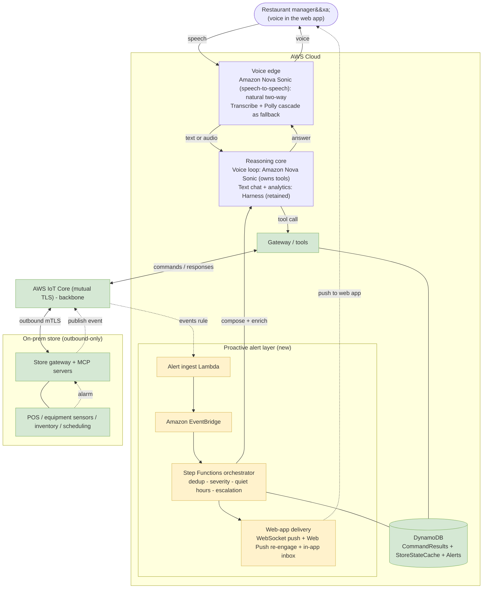
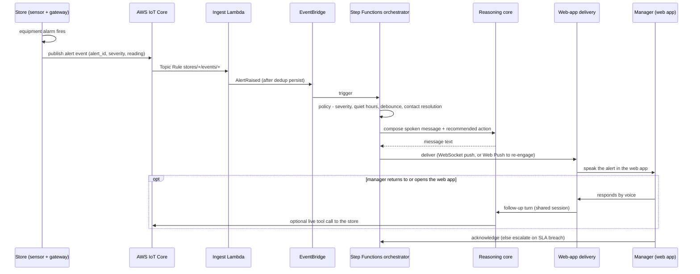

# Voice + Proactive Alerting Architecture — Decision Proposal (Analysis Only, Not Implemented)

> **Status: DECISION PROPOSAL.** The proactive-alerting **Phase 0** recommended here is now
> **implemented and end-to-end validated** as [ADR-006](../adr/ADR-006-proactive-alerting-layer.md) +
> spec `023-proactive-alerting-foundation`
> (Task 9 GATE passed 2026-06-24). The **voice / Nova Sonic Phase 1** parts remain **analysis**
> (decision support, not yet built — see [ADR-005](../adr/ADR-005-nova-sonic-voice-interface.md)).
> This document analyzes options for a voice-driven restaurant manager assistant that can also
> **initiate** contact when a store alert fires. It extends
> [voice-interface-alternate-pattern.md](voice-interface-alternate-pattern.md) (which covered
> reactive voice only).

## TL;DR — recommendation

1. **Keep AWS IoT Core as the backbone** (mandated, and it is the natural ingress for the new
   alert-driven flow — the same IoT-rule-to-Lambda pattern already used for tool responses).
2. **Add an event-driven proactive layer**: the store publishes alert events over IoT Core → an IoT
   Topic Rule → an ingest Lambda → Amazon EventBridge → an alert-policy and orchestration step → a
   web-app delivery channel. This layer is **independent of the reasoning engine**, so it does not
   hinge on the harness decision.
3. **Use Amazon Nova Sonic (speech-to-speech) as the Phase 1 voice engine** for natural,
   low-latency, barge-in two-way voice (reactive and proactive follow-up). The Transcribe + Polly
   cascade is kept only as a fallback. **Retain the AgentCore Managed Harness** for the text chat
   interface and heavy multi-step analytical reasoning; Nova Sonic owns the live voice loop and its
   tool-use.
4. **Proactive delivery is web-app only (no telephony).** Push the alert over the live WebSocket when
   the web app is open, use a **Web Push** notification to re-engage when the tab is not focused, and
   fall back to an in-app alert inbox; escalate on no-ack.
5. **The key decisions are now made** (recorded below): natural two-way voice via Nova Sonic from
   Phase 1, and the harness retained for text and analytical work. The remaining open items are
   operational — re-engagement model, deployment surface, alert policy, and compliance ownership.

## Scope, goals, and constraints

**Goals**

- Let a restaurant general manager interact with the assistant by **voice in the web app** (replacing
  or augmenting the current text chat interface).
- Let the assistant **initiate** a voice interaction when a store alert is received (for example, an
  equipment sensor alarm), tell the manager, and support a follow-up conversation.

**Hard constraints (from the request)**

- **AWS IoT Core stays.** It solves the core connectivity problem (outbound-only, per-device
  identity, firewall traversal) and is non-negotiable.
- **The AgentCore Managed Harness is negotiable.** It may stay or be replaced if it blocks a better
  architecture.
- **Voice happens in the web app only. No telephony** — no phone calls, SMS, or similar channels.
- **Do not implement.** This is analysis and a recommendation only.

**Non-goals**

- **No telephony.** No phone calls, SMS, or similar modes. The manager interacts with the assistant
  only through the **web app**, and proactive alerts are delivered into that web app.
- No new store hardware assumptions beyond the existing outbound MQTT connection.
- No change to the secure-remote-tool-invocation security model (outbound-only, per-store isolation).

## What we have today

The current system (see [reference-architecture.md](reference-architecture.md)) is a **reactive,
request-response** assistant:

- **Reasoning**: a single AgentCore Managed Harness (inline tools, Bedrock, AgentCore Memory),
  invoked by the chat backend on each user turn.
- **Transport**: AWS IoT Core (mutual TLS, X.509). The cloud publishes a command to
  `stores/{id}/commands/{domain}`; the store replies on `stores/{id}/responses/{correlation_id}`.
- **In-process round-trip** (current voice/chat path): the backend publishes and blocks on a SigV4
  MQTT-over-WebSocket subscription to the response topic.
- **Event-driven relay** (also deployed): relay Lambdas + DynamoDB (CommandResults, StoreStateCache) +
  an IoT Topic Rule on `stores/+/responses/+` → a response-handler Lambda, with write-through of
  read results to StoreStateCache for last-known-state fallback.
- **Store side**: an outbound-only MQTT client, four MCP servers, a correlation-id dedup cache.
- **Web app**: a React dashboard with a WebSocket to the backend for live state (and an agent-activity
  log). This existing server-push channel is the natural carrier for proactive alerts.

**Key fact for this proposal**: the store is **request-response only today**. Equipment alerts
exist in the model (severity, status, the `acknowledge_alert` tool, injectable `equipment_failure`
events), but they are surfaced **only when the cloud pulls** `get_equipment_status`. The store does
**not** publish unsolicited events. Proactive alerting therefore needs a new store-to-cloud event
path — which IoT Core supports natively over the connection the store already holds open.

## Relevant project learnings (carried into this design)

- **IoT Core is a proven bidirectional, event-driven bus here.** The `stores/+/responses/+` Topic
  Rule → Lambda pattern is validated; the alert path is the same shape (`stores/+/events/+` → an
  ingest Lambda). Reuse, not invention.
- **Per-device isolation via `${iot:Connection.Thing.ThingName}`** already scopes each store to its
  own topic space; extend the policy to cover an `events/*` publish grant and isolation holds.
- **At-least-once + idempotency.** QoS 1 plus a correlation/dedup cache gives at-most-once effect.
  Alerts need the same discipline (an alert id, cloud-side dedup/debounce) to avoid double-notifying
  on redelivery or a flapping sensor.
- **StoreStateCache (last-known-state) is a latency lever.** A live tool round-trip over IoT takes
  seconds; for voice that matters. Answering reads from cache with a staleness note (and refreshing
  in the background) keeps voice snappy. Proactive alerts carry their own data, so narration needs
  no round-trip at all.
- **The web app already has a server-push channel** (the live-state WebSocket), so proactive delivery
  reuses existing plumbing rather than introducing a new outbound system.
- **Harness operational facts** (if retained): `invoke_harness` needs both `InvokeHarness` and
  `InvokeAgentRuntime`; pin the model and keep the role Bedrock scope in lockstep; inline tool specs
  must match the real store tool signatures.
- **No PII/PCI through the agent pipeline**; outbound-only; least privilege. Voice adds an audio PII
  surface, addressed below.

## The two new problems

### Problem 1 — Voice input/output (reactive)

Replace or augment the text box with speech **in the web app**. This is well understood and was
analyzed in the alternate-pattern doc: a cascading pipeline (Amazon Transcribe streaming STT →
reasoning → Amazon Polly TTS), or a speech-to-speech model. The reasoning core consumes and returns
text today, so a cascade slots in without backend change.

### Problem 2 — Proactive, agent-initiated contact (the architectural pivot)

This is the harder and more interesting requirement. The system today is **pull**: nothing happens
until the manager asks. The alert feature is **push**: the store emits an event, and the cloud must
decide to reach the manager **through the web app**, deliver the message **as voice**, and then
support a two-way follow-up. Because the only channel is the web app, proactive delivery must push
into a live session or re-engage a closed one. This inverts the interaction model and forces three
new capabilities the current architecture does not have:

1. **Store-to-cloud event ingestion** (unsolicited alerts), not just command responses.
2. **A cloud decisioning layer** (which alerts notify whom, when, how — with dedup, severity,
   quiet hours, and escalation).
3. **A server-initiated path to the manager web app** (push into a live WebSocket session, or a Web
   Push notification to re-engage a backgrounded/closed tab), versus the current model where the
   human always initiates.

Problem 2, not Problem 1, is what should drive the architecture.

## Decision dimensions and options

### D1 — Voice interaction model

**Decision: speech-to-speech (Amazon Nova Sonic).** Natural two-way voice is required from Phase 1, so
the cascade is retained only as a fallback (a text/accessibility path, or if Nova Sonic proves
unsuitable).

| Option | What it is | Strengths | Weaknesses |
|---|---|---|---|
| **Cascade** (Transcribe streaming + Polly) | STT → text reasoning → TTS | Minimal change; reuses the text reasoning core unchanged; simple to reason about; great for push-to-talk Q&A and one-way alert narration | Stitched turn-taking; higher end-to-end latency; no native barge-in; less natural for rich two-way dialogue |
| **Speech-to-speech** (Amazon Nova Sonic) | One model, audio in and audio out, over `InvokeModelWithBidirectionalStream` | Lowest conversational latency; native barge-in and turn-taking; can call tools; runs in the browser over WebRTC/WebSocket; ideal for a proactive web-app conversation where the manager talks back | Owns the conversation loop and tool-use, so it changes the role of the harness; newer service (maturity/limits); tool round-trip over IoT still bounds tool-using turns |

### D2 — Reasoning runtime (is the Managed Harness a blocker?)

**Verdict: Nova Sonic owns the live two-way voice loop; the harness is retained for text and
analytical work.** The harness was never a blocker for the feature (the proactive layer is
engine-independent), but it is not the right engine for live two-way voice — that is Nova Sonic.

- For **reactive Q&A** it works today (validated).
- For **proactive narration** it works: an alert orchestrator can invoke it with a synthesized
  prompt (compose a spoken alert and a recommended action). No blocker.
- For a **live, low-latency, barge-in voice conversation**, the harness is awkward: it is a
  turn-based `invoke` with seconds-scale tool round-trips and an in-process poll model, not a
  streaming duplex engine. A cascade has the same limitation. The component that should own live
  turn-taking is either a browser real-time-audio layer driving the cascade, or a speech-to-speech
  model (Nova Sonic) in the browser.

| Option | Role | When to choose |
|---|---|---|
| **Harness (retained)** | Text chat interface + heavy multi-step analytical reasoning; NOT the live voice loop | Chosen: kept alongside Nova Sonic for the non-voice and analytical paths |
| **Nova Sonic (selected for voice)** | Owns the live two-way voice loop; calls gateway tools directly | Chosen: natural two-way voice is required from Phase 1 |
| **Self-hosted loop** (the idle durable-Lambda layer) | Full control of the loop | Only if a managed option cannot meet a hard requirement; ADR-001/003 already moved away from this |

### D3 — Proactive delivery channel (web-app only, no telephony)

The manager interacts only through the web app, so every proactive channel terminates there.

| Channel | Mechanism | Best for | Notes |
|---|---|---|---|
| **Live WebSocket push** (primary) | Server pushes the alert over the open WebSocket (the web app already runs one for live state); the client speaks it via Polly or a Nova Sonic session | The web app is open — for example, an always-on in-store display | Lowest latency; no extra permission; the common case for a dedicated store tablet |
| **Web Push re-engage** | A service-worker Web Push notification wakes/notifies the browser; the manager clicks it to focus the app, which reconnects and speaks the alert | The tab is backgrounded, or the browser is running but the app is not focused | Requires the manager to have granted browser notification permission; a standard browser capability, no telephony |
| **In-app alert inbox** (floor) | Unreached alerts are queued and surfaced with a badge and audio replay on next open | The web app is fully closed and Web Push is not permitted | Guarantees no alert is silently lost even when real-time delivery is impossible |

A real deployment uses a **policy** (severity, quiet hours, escalation) to choose among these. The
honest limit of a web-app-only design: if the web app is closed **and** Web Push is not permitted,
real-time voice delivery is not possible and the alert waits in the inbox. A dedicated always-on
in-store device running the web app makes the live-WebSocket case the norm and largely removes this
gap.

### D4 — Alert ingestion and cloud orchestration

- **Ingestion**: the store publishes alert events to `stores/{id}/events/{domain}` (QoS 1). An IoT
  Topic Rule on `stores/+/events/+` invokes an **ingest Lambda** — identical in shape to the
  existing response-handler rule.
- **Decoupling**: the ingest Lambda normalizes the alert, persists it (a DynamoDB Alerts table), and
  publishes to **Amazon EventBridge**. This separates capture from policy and routing, matching the
  AWS guidance on event-based agent coordination.
- **Orchestration**: an **AWS Step Functions** workflow (or a policy Lambda) applies dedup/debounce,
  severity thresholds, quiet hours, contact resolution, delivery, acknowledgment tracking, and
  escalation. Step Functions gives durable retries and a visible state machine for a safety-relevant
  path.

## Recommended final architecture

A layered design in which **IoT Core is the shared backbone for both directions**, a **reasoning
core** serves both reactive and proactive flows, the **voice edge is Amazon Nova Sonic** (speech-to-speech), with the cascade kept as a fallback, and a **new event-driven proactive layer** delivers store alerts to the manager web app
as voice. The voice edge and the proactive delivery channel are deliberately decoupled from the
reasoning core so the harness-versus-Nova-Sonic decision can be made (and revisited) without
reworking the rest.

_Figure 1 — Target architecture. Reactive voice (manager → edge → reasoning → tools → IoT → store →
back) and the new proactive path (store alarm → IoT event → ingest → EventBridge → orchestrator →
web-app delivery → manager) share IoT Core and the reasoning core. Phase 1 uses Nova Sonic for the
voice loop; the harness is retained for text chat and analytical work._

## Proactive alerting subsystem (the new part, in detail)

1. **Store emits an event.** When an alarm fires (for example, a walk-in cooler breaches its
   threshold), the store gateway publishes an alert to `stores/{id}/events/{domain}` (QoS 1) with an
   `alert_id`, severity, equipment id, reading, and timestamp. This is a small store-side addition;
   the outbound connection already exists. The per-device IoT policy is extended with a publish grant
   on `stores/{thing}/events/*`, so per-store isolation is preserved.
2. **Ingest and dedup.** An IoT Topic Rule on `stores/+/events/+` invokes an ingest Lambda that
   normalizes the event, writes it to an Alerts table keyed by `alert_id` (idempotent under QoS-1
   redelivery and sensor flapping), and emits an `AlertRaised` event to EventBridge.
3. **Decisioning (policy).** A Step Functions workflow applies: **severity threshold** (do not notify
   for low severity), **debounce/dedup** (collapse flapping), **rate limiting**, **quiet hours**
   (with a critical override), and **escalation** rules. This is the guard against alarm fatigue and
   3 a.m. nuisance notifications.
4. **Contact resolution.** Map store → the right person → web-app destination. **Synergy: the existing
   Schedule domain** (`get_current_shifts`) can identify who is on shift / on call right now, so the
   alert targets the person actually in the building. A directory maps the store to the on-call
   manager web-app session and Web Push subscription (PII — protected, consent-tracked).
5. **Compose and enrich.** The orchestrator invokes the reasoning core to turn the raw alert into a
   concise spoken message and a recommended action. The alert payload already carries the reading, so
   narration needs **no tool round-trip**; if more context helps, it is read from StoreStateCache
   (last-known-state) rather than a live call.
6. **Deliver (web app only).** The channel is chosen by policy: a push over the **live WebSocket** if
   the web app is open; a **Web Push** notification to re-engage a backgrounded or closed tab if not;
   and an **in-app alert inbox** as the floor when neither is available. No telephony.
7. **Two-way continuity.** When the manager engages (returns to or opens the web app), the
   interaction becomes a normal voice session that **shares the reasoning core and session memory**,
   so the manager can ask follow-ups (what is the temperature now), take action (acknowledge the
   alert, set a timer, see who is on shift), and those actions flow back through the gateway → IoT →
   store. Proactive and reactive converge here — a strong reason to keep one reasoning core.
8. **Acknowledge and escalate.** Delivery and acknowledgment are tracked. If the alert is not
   acknowledged within an SLA, the orchestrator escalates (retry the push, notify a backup from the
   schedule, raise the on-screen severity). Acknowledgment reuses the existing `acknowledge_alert`
   tool semantics.

_Figure 2 — Proactive alert-to-voice sequence. The voice delivery and follow-up are a Nova Sonic
session in the browser; the orchestrator invokes it to compose and speak the alert, then converse._

## Why IoT Core is the right backbone for this (and not just retained by mandate)

The proactive requirement actually **strengthens** the IoT Core decision:

- IoT Core is already a **bidirectional, event-driven** bus. The store holds one outbound mTLS
  connection; adding an inbound-to-cloud alert stream is just a new topic and a new Topic Rule — no
  new connectivity model, no inbound ports at the store, no change to the security posture.
- The **Topic Rule → Lambda** ingestion pattern is identical to the validated response path, so the
  alert path is low-risk reuse.
- **Per-device identity (X.509)** means an alert is provably from the device that owns the topic —
  important when an alert can trigger a proactive notification. Spoofed alerts are blocked by the
  same thing-name policy that already isolates command/response topics.
- Offline behavior already understood: if the store briefly disconnects, queued events are delivered
  on reconnect (persistent session), so alerts are not silently lost.

A non-IoT alternative (for example, an inbound HTTPS webhook from the store) would reintroduce
exactly the inbound-connectivity problem the architecture was built to avoid. IoT Core is the
correct backbone on the merits, not only by constraint.

## Reasoning engine: recommendation and the harness decision

**Decision: Amazon Nova Sonic is the voice engine from Phase 1 (natural two-way), and the AgentCore
Managed Harness is retained for the text chat interface and heavy analytical reasoning.**

Rationale:

- **Natural two-way voice is the requirement**, and a barge-in, low-latency duplex conversation is
  precisely what **Nova Sonic** provides (continuous duplex audio, tool use, browser real-time
  audio). The Transcribe + Polly cascade cannot do natural turn-taking, so it is kept only as a
  fallback.
- **Nova Sonic owns the live voice loop and its tool-use**, calling the existing gateway tools over
  the IoT round-trip. The store-side contract is unchanged; only the engine that drives tool calls
  changes for the voice path.
- **The harness is retained** for the text chat interface and heavy multi-step analytical reasoning
  (trend analysis, anomaly explanation), where a text agent loop is stronger than a speech model. It
  is already deployed and cheap to keep; revisit retirement if it goes unused.
- The design still **decouples the voice edge from the store-side contract**, so the engine choice
  never touches IoT Core, the gateway, the tools, or the proactive layer.

**Accepted tradeoffs of choosing Nova Sonic at launch:** a newer service sits on the critical path,
and tool-use must be re-wired from the harness inline-tool path into Nova Sonic calling the gateway
(the project lesson that inline tool specs must match the real store tool signatures applies). These
were weighed and accepted in favor of natural two-way voice.

One latency caveat applies to **either** engine: a turn that needs a **live** store read is bounded
by the IoT round-trip (seconds). Mitigate with StoreStateCache (answer from last-known-state with a
staleness note, refresh in the background). Proactive narration is unaffected because the alert
carries its own data.

## Cross-cutting concerns

### Security and compliance

- **No telephony, lighter compliance.** Because there are no phone calls or SMS, telephony rules (for
  example, TCPA-style consent and calling-time restrictions) do not apply. The remaining consent
  surface is **browser notification permission** for Web Push, granted by the manager in the browser.
  Quiet hours and a critical-override policy still govern how aggressively the web app notifies.
- **New PII surfaces.** Voice audio (Transcribe / Nova Sonic) and **manager web-app session
  identifiers and Web Push subscriptions** are PII (no phone numbers, since there is no telephony).
  Keep AWS credentials server-side, encrypt in transit, avoid persisting raw audio, scope and
  consent-track the contact directory, and keep payment-card and employee PII out of the agent
  pipeline as today.
- **Alert authenticity.** Because an alert can trigger a proactive notification, it must be
  trustworthy. The existing mTLS per-device identity and `${iot:Connection.Thing.ThingName}` policy
  ensure a store can only raise alerts on its own topic — extend the same policy to `events/*`.
- **Least privilege.** New roles (ingest Lambda, orchestrator, Web Push sender) are scoped to their
  specific tables, topics, and resources — no wildcards, consistent with the project IAM posture.

> _An organizational security-policy (ARCC) reconciliation has not been performed for this proposal.
> Audio-PII handling, browser-notification consent, and contact-directory access in particular should
> be validated against organizational guidance before implementation._

### Reliability

Alerts can be safety- and food-safety-relevant, so the proactive path is treated as critical:
at-least-once delivery, idempotent dedup, durable orchestration (Step Functions retries),
acknowledgment tracking, and escalation on no-ack. The in-app inbox guarantees an alert is never
silently lost even when real-time delivery is impossible. Dedup/debounce also protect the **human**
from alarm fatigue, which is itself a reliability property (a manager who is spammed stops looking).

### Latency

- Conversational latency: Nova Sonic is materially better than a cascade for turn-taking
  and barge-in.
- Tool-call latency: bounded by the IoT round-trip for **either** engine; mitigated by
  StoreStateCache for reads.
- Proactive narration latency: low, because the alert payload carries the data.

### Cost (qualitative, not estimated here)

New cost drivers: streaming ASR/TTS or Nova Sonic streaming, EventBridge/Step Functions executions,
and Web Push delivery. All are pay-per-use and scale to zero between events, consistent with the
existing serverless posture. There are no telephony minutes. Obtain estimates from the AWS pricing
tools before committing.

### Observability

Reuse the existing CloudWatch/X-Ray posture. The proactive path adds naturally observable hops
(EventBridge events and Step Functions execution history), which is a benefit for auditing a
safety-relevant feature.

## Phased adoption path (sequencing, not implementation)

The phases are ordered so a working feature ships early and the higher-risk engine change is made
later, with data.

- **Phase 0 — Foundation (engine-agnostic).** Add the store-to-cloud event path (new `events` topic
  + IoT policy grant + ingest Lambda), the Alerts table, EventBridge, and the Step Functions
  orchestrator skeleton with the alert policy (severity, dedup, quiet hours, contact resolution via
  the schedule domain, acknowledgment + escalation). No voice yet. This is the bulk of the new
  architecture and is independent of every voice/engine decision.
- **Phase 1 — Natural two-way voice via Nova Sonic (harness retained).** Stand up a Nova Sonic
  speech-to-speech session in the web app for live, barge-in conversation — both reactive Q&A and
  proactive alert follow-up — wiring its tool-use to the existing gateway/IoT round-trip. Proactive
  delivery rides the web app (WebSocket push when open, Web Push to re-engage when not, in-app inbox
  as the floor): the orchestrator opens or targets a Nova Sonic session that speaks the alert and
  then converses. The **harness is retained** for the text chat interface and analytical reasoning.
  The Transcribe + Polly cascade is built only if a non-voice/accessibility fallback is needed.
- **Later — optimization and consolidation.** Tune latency (StoreStateCache for live reads), expand
  the alert policy, and revisit whether the harness is still needed once Nova Sonic coverage is
  proven. No change to IoT Core, the gateway, the tools, or the proactive layer.

Phase 0 is a prerequisite for Phase 1. IoT Core, the gateway, the tools, and the proactive layer are
unchanged regardless of the voice engine — the point of decoupling the voice edge from the store-side
contract.

## Decision matrix (summary)

| Dimension | Recommended | Alternative | Key deciding factor |
|---|---|---|---|
| Transport backbone | **AWS IoT Core** (commands/responses + new events) | none (mandated; also correct on merits) | n/a |
| Alert ingestion | **IoT Topic Rule → ingest Lambda → EventBridge** | direct Lambda without EventBridge | need for decoupled routing + auditability |
| Orchestration | **AWS Step Functions** (policy + escalation) | single policy Lambda | durability/visibility of a safety path |
| Voice edge | **Amazon Nova Sonic** (speech-to-speech) | Transcribe + Polly cascade (fallback) | DECIDED: natural two-way voice required |
| Reasoning core | **Nova Sonic** owns the voice loop; **harness retained** for text + analytics | retire harness | DECIDED: retain |
| Proactive delivery | **Web app: WebSocket push + Web Push re-engage (+ in-app inbox)** | WebSocket-only (no re-engage) | reachability when the web app is closed |
| Contact resolution | **Schedule-domain on-call + directory** | static directory only | whether on-call accuracy matters |

## Decisions made and remaining open items

**All operational items are now settled** (2026-06-24). Items 1 and 6 were decided when this
proposal was written; items 2-5 were settled with the stakeholder on 2026-06-24 and are baked into
the Phase 0 spec `023-proactive-alerting-foundation`;
item 7 is a Phase 1 (voice) concern. **Phase 0 is now implemented and end-to-end validated** (spec 023
Tasks 1-9; Task 9 GATE passed 2026-06-24); the one remaining gate to fully accept
[ADR-006](../adr/ADR-006-proactive-alerting-layer.md) is ARCC reconciliation of the new IoT grants.

1. **Voice-naturalness bar — DECIDED.** Natural two-way voice is required from Phase 1, so Amazon
   Nova Sonic is the voice engine and the cascade is a fallback only.
2. **Re-engagement when the web app is closed — DECIDED (2026-06-24).** Tiered: the **in-app inbox**
   is the durable floor and a **live WebSocket push** reaches the display when connected; **Web Push
   is deferred to Phase 1**. (Reinforced by #3: an always-on display keeps the live channel available.)
3. **Deployment surface — DECIDED (2026-06-24).** A dedicated **always-on in-store display only**;
   managers' personal devices are not a target. This makes the live-WebSocket case the norm.
4. **On-call and escalation policy — DECIDED (2026-06-24).** **There is no on-call to escalate to**,
   so Schedule-domain contact resolution and any multi-person escalation chain are dropped. Retained:
   severity gating (warning+ notifies, info inbox-only), quiet hours with a critical override, dedup
   by (store, equipment, condition) within ~15 min, and an acknowledgment SLA (critical 5 min /
   warning 30 min) after which the alert **re-surfaces on the same display**, bounded.
5. **Compliance ownership — DECIDED (2026-06-24).** Owned by the web-app/feature team. Phase 0:
   `Alerts`-table TTL retention; no raw audio. Phase 1: Web Push consent + any transcript retention.
   **ARCC reconciliation remains pending** (the `search_arcc` tool was unavailable in these sessions).
6. **Harness end-state — DECIDED.** Retained for the text chat interface and analytical reasoning;
   Nova Sonic owns the voice loop. Revisit retirement later if the harness goes unused.
7. **Latency tolerance — Phase 1.** Whether voice reads may be answered from StoreStateCache
   (last-known-state, with a staleness note) vs always live is a Phase 1 voice concern; Phase 0
   proactive narration carries its own data and needs no round-trip.

## References

- [voice-interface-alternate-pattern.md](voice-interface-alternate-pattern.md) — the reactive-only
  voice proposal this document extends.
- [reference-architecture.md](reference-architecture.md) — the current implemented architecture.
- AWS Prescriptive Guidance: [Agentic AI patterns (introduction)](https://docs.aws.amazon.com/prescriptive-guidance/latest/agentic-ai-patterns/introduction.html)
  and [Speech and voice agents](https://docs.aws.amazon.com/prescriptive-guidance/latest/agentic-ai-patterns/speech-and-voice-agents.html)
  (event-based coordination and voice patterns).
- Amazon Nova Sonic: [bidirectional streaming API](https://docs.aws.amazon.com/nova/latest/userguide/speech-bidirection.html)
  (browser real-time audio for the voice edge).
- [ADR-003 — AgentCore Managed Harness](../adr/ADR-003-agentcore-managed-harness.md),
  [ADR-004 — IoT Core broker migration](../adr/ADR-004-iot-core-broker-migration.md).
- [ADR-005 — Nova Sonic voice interface](../adr/ADR-005-nova-sonic-voice-interface.md),
  [ADR-006 — Proactive alerting layer](../adr/ADR-006-proactive-alerting-layer.md) — the decisions in this proposal, formalized (Proposed; spike/spec pending).

---

_Analysis only. No code, infrastructure, or configuration described here has been implemented. Next
step on acceptance: split the agreed decisions into ADRs and per-phase specs (requirements, design,
tasks)._
