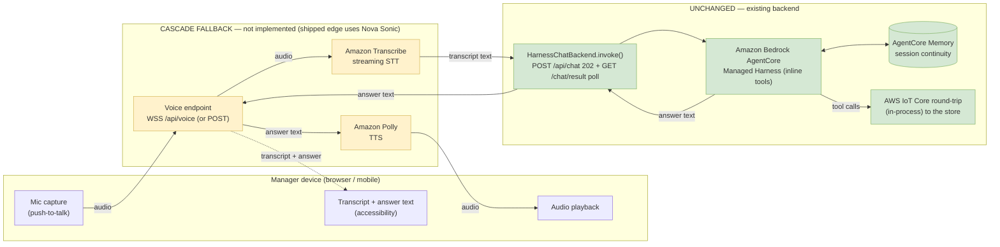

# Voice Interface for the Restaurant Manager Agent — Cascade Fallback Pattern (Transcribe + Polly)

> **Status: DOCUMENTED FALLBACK PATTERN — this Transcribe + Polly cascade is NOT implemented; voice shipped via Amazon Nova Sonic.**
> A voice interface **is** implemented in this project — but **not** the cascade described here. The
> shipped voice edge is **Amazon Nova Sonic (speech-to-speech)**: a live, two-way, barge-in voice
> loop chosen in [ADR-005](../adr/ADR-005-nova-sonic-voice-interface.md) (Accepted 2026-06-28) and
> built + deployed + on-display-validated in spec 025
> (Phase 1, 2026-06-29; merged to `main`; code in `simulator/voice/broker.py`). The
> [reference architecture](reference-architecture.md) now includes that Nova Sonic voice edge as an
> implemented extension.
>
> This document is retained as the **documented fallback**. The reactive-only Transcribe → harness →
> Polly *cascade* was the **original** voice proposal (2026-06-19); it was **demoted to a fallback**
> (an accessibility / text-equivalent path, and the contingency if the speech-to-speech engine is
> unsuitable) when the product direction was locked to natural two-way voice
> ([ADR-005](../adr/ADR-005-nova-sonic-voice-interface.md), alternative A). **No code,
> infrastructure, configuration, or tests in this repository implement this cascade** — treat it as a
> design on the shelf, not as shipped behavior. Where this document says "unchanged backend," that
> describes how the *cascade fallback would* attach; the *implemented* Nova Sonic loop instead owns
> its own tool use (see the contrast note below).

## Summary

This document describes the **Transcribe + Polly cascade** — the *fallback* voice pattern. It follows
the AWS Prescriptive Guidance [Speech and voice agents](https://docs.aws.amazon.com/prescriptive-guidance/latest/agentic-ai-patterns/speech-and-voice-agents.html)
pattern's **cascading speech pipeline**: speech-to-text (STT) → LLM reasoning → text-to-speech (TTS).
Its appeal is minimal change: the LLM-reasoning stage is exactly where the **Amazon Bedrock
AgentCore Managed Harness** already sits (consuming text, producing text), so a voice layer can be
added *in front of* the existing text backend rather than woven through it. It satisfies three
constraints — **minimize changes**, **continue to use the AgentCore Managed Harness**, and
**continue to use AWS IoT Core** — and being turn-based (push-to-talk) it is a good fit for an
accessibility / text-equivalent path.

**What actually shipped is different.** Because natural, interruptible two-way voice was required from
Phase 1 — which a turn-based cascade cannot deliver — the project adopted **Amazon Nova Sonic
(speech-to-speech)** as the primary voice engine ([ADR-005](../adr/ADR-005-nova-sonic-voice-interface.md);
spec 025, deployed 2026-06-29). Unlike this cascade, the
Nova Sonic loop **owns its own tool use** over the gateway/IoT round-trip and does **not** route
reasoning through the harness; the harness is retained for the **text** chat interface and heavy
analytical reasoning. This cascade remains documented below as the fallback.

## Relationship to the reference architecture (how the cascade fallback would attach)

The cascade's design goal is that everything in the [reference architecture](reference-architecture.md)
stays as-is:

- the **AgentCore Managed Harness** (single harness, inline tools, Bedrock) — unchanged;
- **AgentCore Memory** for same-session continuity — unchanged;
- the **`POST /api/chat` → `202` + `GET /api/chat/result` poll** contract — unchanged (the cascade
  would call the same `HarnessChatBackend` path the chat UI uses today);
- the **AWS IoT Core** outbound round-trip to the store (the in-process round-trip) and the entire store-side
  MCP/data-source layer — unchanged.

In the cascade, the voice layer would interact with the backend exactly as the text chat box does:
submit a text utterance, receive a text answer, converting speech to/from text at the edge.

> **Contrast with the implemented Nova Sonic edge.** The shipped voice path does **not** work this
> way. Nova Sonic runs a bidirectional streaming session (`InvokeModelWithBidirectionalStream`) that
> **owns its own tool use** — calling the gateway/IoT round-trip directly — and its own conversation
> loop; it does **not** go through `HarnessChatBackend` or the `202`+poll contract. The harness,
> AgentCore Memory, IoT Core, and the store-side layer are still reused, but the reasoning and
> tool-orchestration for voice live in Nova Sonic, not the harness. See
> [ADR-005](../adr/ADR-005-nova-sonic-voice-interface.md) and
> [voice-and-proactive-architecture-proposal.md](voice-and-proactive-architecture-proposal.md).

## The pattern: a cascading voice layer

[Amazon Transcribe](https://aws.amazon.com/transcribe/) converts speech from the manager into text;
that transcript flows into the existing chat backend; the text answer from the harness is converted
back to speech with [Amazon Polly](https://aws.amazon.com/polly/) and played to the manager. Figure
1 shows the fallback layering — **cascade** components on the left/middle, the **unchanged** backend
on the right.

_Figure 1 — The cascade fallback (not implemented). The cascading pipeline (Transcribe → unchanged Harness → Polly) wraps the existing text backend; the harness, AgentCore Memory, and the IoT Core round-trip are untouched. This is the fallback design; the shipped voice edge uses Amazon Nova Sonic (see the status note above)._

## How the AWS guidance maps onto the cascade fallback

| Guidance step / service | Cascade instantiation here | Change? |
|---|---|---|
| Voice query + STT (Amazon Transcribe or Lex V2) | **Amazon Transcribe** streaming, invoked server-side | New |
| Streaming / telephony interface (Chime SDK / Connect / IVS) | Browser mic over **WSS to the existing backend** (push-to-talk MVP) | New |
| LLM reasoning (Amazon Bedrock) | **AgentCore Managed Harness** via `invoke_harness` | **Unchanged** |
| Session memory (Amazon DynamoDB) | **AgentCore Memory** (already attached, keyed by `session_id`) | **Unchanged** |
| Voice response + TTS (Amazon Polly) | **Amazon Polly** `SynthesizeSpeech`, invoked server-side | New |
| AWS Lambda glue | The existing **FastAPI backend** (or a Lambda) orchestrates STT → invoke → TTS | New (thin) |
| Observability (CloudWatch / X-Ray) | Same as today | Unchanged |
| Tool execution | **AWS IoT Core** + the in-process round-trip to the store | **Unchanged** |

> Note: the **implemented** Nova Sonic edge maps the "LLM reasoning" and "voice response + TTS" rows
> onto a single speech-to-speech model that also drives tool use, rather than the three separate
> stages above. See [ADR-005](../adr/ADR-005-nova-sonic-voice-interface.md).

## Minimal change set (if the cascade fallback were built)

1. **Frontend (React).** Replace the text input with a push-to-talk mic button and an audio player;
   keep an on-screen transcript and answer panel for accessibility and noisy environments. Reuse the
   existing `session_id` handling.
2. **Backend (one new module / endpoint).** Add `WSS /api/voice` (or `POST /api/voice` with an audio
   blob) that: (a) streams audio to **Amazon Transcribe**; (b) calls the **existing**
   `HarnessChatBackend.invoke(transcript, session_id)` and polls `get_execution_result()` — the
   identical path `routes_chat.py` uses today; (c) sends the answer text to **Amazon Polly**; and
   (d) returns audio plus the transcript and answer text. No change to `harness_backend.py`,
   `harness_tools.py`, the harness, the gateway, or IoT Core.
3. **IAM.** Add `transcribe:StartStreamTranscription*` and `polly:SynthesizeSpeech` to the existing
   backend execution role. Nothing else.

The footprint is intentionally small: a front-end change, one glue endpoint, and two IAM actions.
(For comparison, the implemented Nova Sonic edge instead required three cross-region
`bedrock:InvokeModelWithBidirectionalStream` / `InvokeModelWithResponseStream` / `InvokeModel`
grants on the region-wildcard foundation-model ARN, a curated tool set, and the browser mic transport
— see spec 025.)

## Design considerations

- **Latency and UX.** The backend contract is asynchronous (`202` + poll) because tool round-trips
  take seconds. Voice makes that gap more noticeable, so play a short "let me check..." cue while
  polling. Two latency enhancements keep the backend unchanged: stream Transcribe **partial**
  results to begin sooner, and send the answer to Polly **sentence-by-sentence** so playback starts
  before the full answer is ready. (This turn-based latency and the absence of barge-in are exactly
  why the cascade is a fallback and Nova Sonic is the primary engine.)
- **Security and privacy.** Two items must be resolved before exposing a voice endpoint:
  - A network-exposed audio/WebSocket endpoint must require the **same authentication** as the rest
    of the application. The current `/api/chat*` endpoints are unauthenticated in the simulator, so
    voice (and ideally chat) should be placed behind authentication before exposure.
  - **Voice is PII.** Keep AWS credentials server-side (do not hand Transcribe/Polly credentials to
    the browser), use TLS/WSS for all audio, avoid persisting raw audio, and classify any stored
    transcripts as PII with appropriate retention and access controls.

  > _A security-policy reconciliation was performed for the **shipped Nova Sonic** edge (spec 025
  > Task 7, reconciled against the Recommendation Engine): credentials stay server-side (the browser
  > holds no AWS credential), audio is streamed ephemerally and not persisted, and IAM grants are
  > least-privilege. That reconciliation covers the Nova Sonic path, **not** this cascade — if the
  > cascade is ever built, validate its audio-handling, authentication, and data-retention design
  > against organizational security guidance (ARCC) before exposure._
- **Accessibility and environment.** Keep the on-screen transcript and text answer alongside audio.
  Push-to-talk with a visible transcript is more robust in a loud kitchen than always-on listening —
  a strength that makes the cascade a sensible accessibility fallback.
- **Session continuity.** Reuse the existing `session_id`, so AgentCore Memory continues to provide
  same-session continuity with no change.

## Alternatives considered

- **Speech-to-speech (Amazon Nova Sonic) — SELECTED as the primary voice engine.** A single model
  takes audio in and returns audio out, giving the lowest latency and the most natural, interruptible
  (barge-in) interaction. It was **chosen** over this cascade
  ([ADR-005](../adr/ADR-005-nova-sonic-voice-interface.md), Accepted 2026-06-28; validated by the
  spec 024 spike and built in
  spec 025) because natural two-way voice was required
  from Phase 1, which the turn-based cascade cannot deliver. It does **replace** the harness's
  reasoning for the voice loop and moves tool-use orchestration into the speech model — but calling
  the **same** gateway/IoT round-trip, which did **not** need re-plumbing (the store-side contract is
  unchanged). The harness is **retained** for the text chat interface and heavy analytical reasoning.
  This is why the cascade in this document is now a fallback rather than the primary path.
- **Telephony channel (Amazon Connect / Amazon Chime SDK / Amazon IVS).** Suited to call-in or
  contact-center access (DTMF, IVR, "call the store assistant"). Explicitly ruled **out of scope** by
  stakeholder decision (voice is web-app only — [ADR-005](../adr/ADR-005-nova-sonic-voice-interface.md),
  alternative C). The same backend would stay unchanged behind it if that scope ever changed.

## Why this cascade is the fallback (and not the shipped path)

This cascade was the **original** voice proposal (2026-06-19), when the goal was framed as reactive,
push-to-talk Q&A over the unchanged text backend. When the product direction was locked to **natural,
interruptible two-way voice** (2026-06-22), the turn-based cascade — with additive STT+inference+TTS
latency and no barge-in — could no longer meet the bar, so it was **demoted to a documented
fallback**: an accessibility / text-equivalent path, and the contingency if the speech-to-speech
engine proved unsuitable. **Amazon Nova Sonic** was validated by a spike
(spec 024, GO 2026-06-28), accepted as
[ADR-005](../adr/ADR-005-nova-sonic-voice-interface.md), and shipped in
spec 025 (Phase 1, deployed + on-display validated
2026-06-29).

The cascade itself remains **unbuilt**. If it is ever needed as a real fallback (for example, an
accessibility mode or a Nova Sonic outage path), building it would be a spec-level (Category C)
change: define the endpoint contract, add the Transcribe + Polly integration and IAM, and wire the
front-end — reusing the `HarnessChatBackend` text path described above.

## References

- [ADR-005 — Nova Sonic voice interface](../adr/ADR-005-nova-sonic-voice-interface.md) — **the accepted decision**: Nova Sonic (speech-to-speech) is the primary voice engine; this cascade is the fallback.
- spec 025 — Phase 1 voice edge and its deploy + on-display verdict — the **implemented** Nova Sonic voice edge (deployed + validated 2026-06-29).
- spec 024 — Nova Sonic voice spike — the validation spike (GO) that gated ADR-005.
- [`reference-architecture.md`](reference-architecture.md) — the current, implemented architecture (now includes the Nova Sonic voice edge).
- [`voice-and-proactive-architecture-proposal.md`](voice-and-proactive-architecture-proposal.md) — the broader **decision proposal** (voice engine + agent-initiated proactive alerting).
- AWS Prescriptive Guidance — [Speech and voice agents](https://docs.aws.amazon.com/prescriptive-guidance/latest/agentic-ai-patterns/speech-and-voice-agents.html) (the cascade pattern this fallback follows).
- [Amazon Transcribe](https://aws.amazon.com/transcribe/) (STT) and [Amazon Polly](https://aws.amazon.com/polly/) (TTS).
- [ADR-003 — AgentCore Managed Harness](../adr/ADR-003-agentcore-managed-harness.md) (retained for text/analytics).
- [ADR-004 — IoT Core broker migration](../adr/ADR-004-iot-core-broker-migration.md) (unchanged transport).

---

_The Mermaid diagram above renders directly on GitHub and in compatible Markdown viewers._
