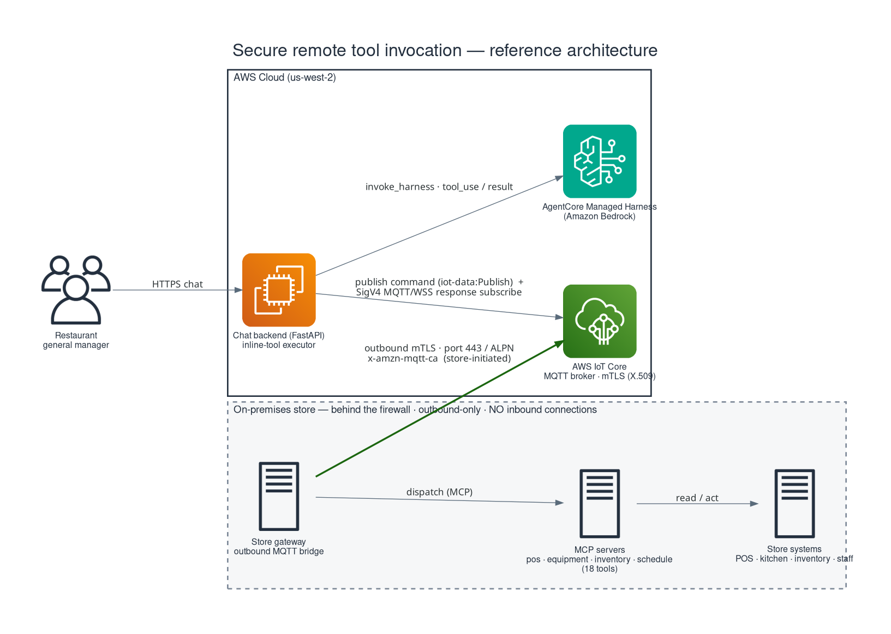

# Restaurant Manager Agent — Simulator

A realistic restaurant simulator that models POS transactions, kitchen equipment, inventory levels, and employee scheduling. It exposes state through a REST API, a WebSocket stream, and four MCP servers, and optionally relays tool invocations from cloud-hosted AI agents through an MQTT bridge — without ever accepting an inbound network connection from the internet.

The simulator is the on-premises half of the architecture described in the companion blog post, Secure remote tool invocation for cloud-based AI agents in retail and restaurant environments.

## What this is for

Cloud-hosted AI agents (the **AWS Bedrock AgentCore Managed Harness** as of spec 022 / [ADR-003](docs/adr/ADR-003-agentcore-managed-harness.md); previously AWS Lambda Durable Functions per FEAT-009, and originally Amazon Bedrock AgentCore on Fargate) need to query and act on systems that live behind a restaurant's firewall. This simulator is the target those agents talk to during development. It implements the same MCP tool interface and MQTT bridge a real store would run, so the full cloud-to-store pipeline can be validated before any physical deployment.

## Architecture



> **Transport:** AWS IoT Core is the sole store↔cloud transport. The earlier
> Amazon MQ (ActiveMQ) broker was decommissioned in
> spec 020 (see
> [ADR-004](docs/adr/ADR-004-iot-core-broker-migration.md)). The simulator's
> bridge still contains a username/password code path for local experiments,
> but the deployed transport is IoT Core with mutual-TLS X.509 auth.

The bridge only opens outbound connections. Cloud agents publish commands to per-domain topics (`stores/{id}/commands/{pos|equipment|inventory|schedule}`) and receive responses on per-correlation-id topics (`stores/{id}/responses/{correlation_id}`). Malformed commands go to a dead-letter topic.

## Quick start

### Prerequisites
- Python 3.11+
- Node.js 18+ (for the frontend)

### Backend

```bash
python -m venv .venv
source .venv/bin/activate            # Windows: .venv\Scripts\activate
pip install -e ".[dev]"
python main.py
```

The backend starts on `http://localhost:8000`. The simulation begins at 07:00 simulated time running at 10x speed (tick interval 1s → 10 simulated seconds per real second). Configurable in `config/simulation.json`.

### Frontend

```bash
cd frontend
npm install
npm run dev
```

Open `http://localhost:5173`. The Vite dev server proxies API and WebSocket requests to the backend.

### MCP servers over stdio

Each domain server can run standalone for testing with Claude Code, `mcp-cli`, Anthropic Workbench, or any MCP client:

```bash
python -m simulator.mcp.run_server pos
python -m simulator.mcp.run_server equipment
python -m simulator.mcp.run_server inventory
python -m simulator.mcp.run_server schedule
```

The runner loads configs from `config/` and initializes a StateStore. It does not start the simulation engine, so the state is static — useful for validating tool schemas and response shapes.

## Project structure

```
├── main.py                          # Backend entrypoint
├── pyproject.toml                   # Python dependencies
├── .env.example                     # MQTT bridge configuration template
├── config/
│   ├── menu.json                    # 13 menu items, 21 ingredients
│   ├── equipment.json               # 6 kitchen equipment pieces
│   ├── staff.json                   # 8 employees with weekly shifts
│   └── simulation.json              # Timing, rates, speed defaults
├── simulator/
│   ├── engine/                      # Simulation modules
│   │   ├── clock.py                 # Virtual clock (1x–60x speed)
│   │   ├── pos.py                   # Order generation + lifecycle
│   │   ├── equipment.py             # Thermal drift + failures
│   │   ├── inventory.py             # Stock depletion + waste
│   │   ├── schedule.py              # Shift management + labor cost
│   │   └── engine.py                # Tick orchestrator
│   ├── state/store.py               # In-memory state + event emission
│   ├── api/                         # FastAPI REST endpoints
│   ├── websocket/server.py          # Real-time broadcast + agent-log
│   ├── mcp/                         # 4 MCP servers (18 tools)
│   │   ├── pos_server.py
│   │   ├── equipment_server.py
│   │   ├── inventory_server.py
│   │   ├── schedule_server.py
│   │   ├── registry.py              # Central tool-name → callable map
│   │   ├── run_server.py            # stdio CLI entrypoint
│   │   └── _errors.py               # Structured error envelope
│   ├── mqtt/                        # Store gateway — outbound MQTT
│   │   ├── config.py                # MQTTConnectionConfig + env loader
│   │   ├── client.py                # aiomqtt wrapper + reconnect
│   │   ├── dedup.py                 # CorrelationIdCache (LRU + TTL)
│   │   ├── publisher.py             # Response publisher + disconnect buffer
│   │   ├── dispatcher.py            # Parse, validate, dispatch
│   │   └── bridge.py                # Orchestrator (start/stop)
│   └── models/                      # Pydantic data models
├── frontend/                        # React + Vite + Tailwind dashboard
└── tests/                           # pytest + hypothesis
```

## REST API

| Method | Endpoint | Description |
|--------|----------|-------------|
| GET | `/api/pos/orders` | Active and recent orders |
| GET | `/api/pos/sales/daily` | Daily sales summary |
| GET | `/api/pos/transactions` | Transaction history |
| GET | `/api/equipment/status` | All equipment state |
| GET | `/api/equipment/{id}/log` | Temperature history |
| POST | `/api/equipment/{id}/timer` | Set equipment timer |
| GET | `/api/inventory/levels` | Current stock levels |
| POST | `/api/inventory/waste` | Log waste event |
| GET | `/api/schedule/current` | Current shift info |
| POST | `/api/schedule/clock` | Clock in/out employee |
| POST | `/api/sim/control` | Pause, resume, set speed |
| POST | `/api/sim/inject-event` | Trigger rush, failure, etc. |
| GET | `/api/sim/state` | Full state snapshot |
| POST | `/api/chat` | Start an agent chat turn (returns 202 + execution id) |
| GET | `/api/chat/result/{execution_id}` | Poll for the agent response |
| GET | `/api/chat/history/{session_id}` | Conversation history (AgentCore Memory) |
| GET | `/api/health` | Health check |

The `/api/chat*` endpoints front the cloud agent layer, which is the AgentCore
Managed Harness (see spec 022). It is
the **only** chat backend: the `AGENT_BACKEND` selector and the durable-supervisor
alternative were removed when the durable layer was decommissioned in spec 022
Task 6.

## MCP tools

Four domain servers, eighteen tools total. Tool names are the stable contract between store and cloud — cloud agents dispatch by name.

| Server | Tools |
|--------|-------|
| `pos-mcp` | `get_daily_sales`, `get_active_orders`, `get_transaction_history`, `void_order` |
| `equipment-mcp` | `get_equipment_status`, `set_timer`, `get_temperature_log`, `acknowledge_alert`, `get_active_alerts`, `acknowledge_proactive_alert` |
| `inventory-mcp` | `get_stock_levels`, `log_waste`, `get_usage_report`, `check_reorder_status` |
| `schedule-mcp` | `get_current_shifts`, `clock_in`, `clock_out`, `get_labor_cost` |

Mutating tools (`void_order`, `set_timer`, `acknowledge_alert`, `acknowledge_proactive_alert`, `log_waste`, `clock_in`, `clock_out`) flow through the StateStore's update path so WebSocket subscribers see changes in real time. Errors are returned as structured envelopes `{error, code}` with machine-readable codes `not_found | invalid_state | invalid_input | internal_error`.

Both invocation paths (stdio and MQTT) call the same underlying tool functions via a central registry (`simulator/mcp/registry.py`).

## MQTT bridge

The bridge makes the simulator reachable from cloud-hosted AI agents without accepting any inbound connection. The deployed transport is **AWS IoT Core** (mutual TLS with X.509 certificates, port 8883). The bridge code is still broker-agnostic and retains a username/password TLS mode for local experiments, but the Amazon MQ (ActiveMQ) broker was decommissioned in spec 020 and is no longer part of the deployed architecture.

Switching auth modes (`mtls` vs `userpass`) is a matter of environment variables; no code change.

### Behavior
- Outbound-only TLS connection. **By default the store connects on port 443 via ALPN** (`x-amzn-mqtt-ca`), reusing the outbound-HTTPS rule most store networks already allow so no separate 8883 firewall rule is needed. Set `MQTT_USE_ALPN=false` with `MQTT_BROKER_PORT=8883` for the classic 8883 path (see *Enable it* below).
- Persistent session (`clean_session=False`) with stable client id equal to `STORE_ID` (which is also the IoT thing name, e.g. `sim-store-001`) so the broker retains queued messages across brief disconnects. Matching the client id to the thing name lets the IoT thing-policy `${iot:Connection.Thing.ThingName}` variables resolve.
- Supervised reconnect with exponential backoff + jitter.
- Commands arrive on per-domain subtopics, responses go to per-correlation-id topics, malformed commands go to a dead-letter topic.
- Correlation-ID cache (1024 entries / 30 minute TTL by default) gives write operations at-most-once effect even under QoS 1 redelivery. Redelivered commands replay the cached response without re-invoking the tool.
- Bounded concurrency (semaphore) and bounded outbound/inbound queues protect the store from overload.
- Structured log events are forwarded to the WebSocket agent-log stream so the dashboard shows MQTT activity alongside REST and MCP invocations.

### Enable it

1. Copy the template and edit:

   ```bash
   cp .env.example .env
   ```

2. Fill in the endpoint and auth block. The deployed transport is **AWS IoT Core (mTLS)**:

   ```env
   MQTT_ENABLED=true
   MQTT_BROKER_ENDPOINT=xxxxxxxx-ats.iot.us-west-2.amazonaws.com
   MQTT_AUTH_MODE=mtls
   MQTT_CLIENT_CERT_PATH=certs/device.pem.crt
   MQTT_CLIENT_KEY_PATH=certs/device.private.key
   MQTT_CA_BUNDLE_PATH=certs/AmazonRootCA1.pem
   STORE_ID=sim-store-001
   MQTT_BROKER_PORT=443
   MQTT_USE_ALPN=true
   ```

   On the deployed EC2 instance, the IoT certificate bundle is fetched from
   Secrets Manager (`restaurant-sim/iot/{STORE_ID}/cert`) at boot and written to
   `/etc/restaurant-sim/certs/`; see
   [`infra/iot-core-broker/`](infra/iot-core-broker/) for provisioning.

   The `MQTT_BROKER_PORT=443` + `MQTT_USE_ALPN=true` lines are the **default**
   (the deployed EC2 store sets them automatically): IoT Core negotiates MQTT +
   mTLS on 443 via the ALPN protocol `x-amzn-mqtt-ca` (`MQTT_ALPN_PROTOCOL`),
   reusing the outbound-HTTPS path so the store network needs no separate
   outbound-8883 firewall rule. To use the classic **8883** path instead, set
   `MQTT_BROKER_PORT=8883` and `MQTT_USE_ALPN=false` — for example behind a
   TLS-terminating/deep-packet-inspecting proxy that only forwards genuine HTTP
   on 443 and would block ALPN-tunneled MQTT. It is a per-network choice.

   A legacy username/password TLS mode still exists in the bridge code for local
   experiments against a generic broker (the Amazon MQ broker itself is retired):

   ```env
   MQTT_ENABLED=true
   MQTT_BROKER_ENDPOINT=<broker-host>
   MQTT_AUTH_MODE=userpass
   MQTT_USERNAME=<username>
   MQTT_PASSWORD=<password>
   STORE_ID=sim-store-001
   ```

3. Restart `python main.py`. The bridge starts automatically.

When `MQTT_ENABLED=false`, everything runs locally — REST, WebSocket, and MCP stdio continue to work unchanged.

### Message formats

Command (inbound, topic `stores/{store_id}/commands/{domain}`):

```json
{
  "correlation_id": "9e2e2f4d-...",
  "tool_name": "get_equipment_status",
  "parameters": {},
  "timeout_ms": 30000,
  "timestamp": "2026-04-17T18:30:00Z",
  "priority": "normal"
}
```

Response (outbound, topic `stores/{store_id}/responses/{correlation_id}`):

```json
{
  "correlation_id": "9e2e2f4d-...",
  "tool_name": "get_equipment_status",
  "status": "success",
  "result": { "equipment": [ /* ... */ ] },
  "duration_ms": 42,
  "timestamp": "2026-04-17T18:30:00.042Z"
}
```

## Configuration

All simulation behavior is driven by JSON config files in `config/`:

- `menu.json` — Menu items, prices, prep times, ingredient requirements
- `equipment.json` — Kitchen equipment with temp thresholds and failure rates
- `staff.json` — Employee roster with roles, pay rates, and weekly shifts
- `simulation.json` — Tick interval, peak hours, order rates, void rate, speed multiplier

Defaults produce a realistic day: tick interval 1s, peak hours 11:00–13:00 and 17:00–20:00, 45 orders/hour at peak, 12 off-peak, average order $14.50, 3% void rate, 10x default speed.

## Deployment

### AWS with CDK (EC2 + ALB, us-west-2)

For dev / demo deploys, spec 004 provides a single-command AWS CDK stack that stands up a VPC, one ARM64 EC2 instance running the simulator, and an **internal** Application Load Balancer fronted by Amazon CloudFront with Cognito edge auth (spec 029). No SSH key, no container image, no CI pipeline — user-data bootstraps the instance on first boot.

```bash
cd infra/simulator-ec2-alb
python3.12 -m venv .venv
.venv/bin/pip install -r requirements-dev.txt
PATH=.venv/bin:$PATH cdk deploy SimulatorEc2AlbStack
```

The stack name is required here: this app also synthesizes a `us-east-1` Lambda@Edge
support stack, so a bare `cdk deploy` fails.

After deploy, the stack prints the **`CloudFrontUrl`** output. Browse to
`https://<CloudFrontDomainName>/` for the dashboard and log in through the Cognito
Hosted UI. The ALB is **internal** as of spec 029 and has no public entry point, so
the old `http://<AlbDnsName>/` route no longer reaches the app. See [`infra/simulator-ec2-alb/README.md`](infra/simulator-ec2-alb/README.md) and an internal design record for prerequisites, smoke tests, MQTT enablement, and destroy.

### Store↔cloud transport: AWS IoT Core (CDK, us-west-2)

The store↔cloud MQTT transport is **AWS IoT Core** (mutual TLS, X.509, port 8883). Spec 020 ([`infra/iot-core-broker`](infra/iot-core-broker/)) provides the cloud-side response path — an `iot-response-handler` Lambda invoked by an IoT Topic Rule on `stores/+/responses/+` — plus per-store provisioning (`provision/provision_store.py`: creates the IoT thing, attaches the shared thing-variable policy, issues a cert, and stores the bundle in Secrets Manager `restaurant-sim/iot/{store_id}/cert`).

```bash
cd infra/iot-core-broker
python3.12 -m venv .venv
.venv/bin/pip install -r requirements-dev.txt
PATH=.venv/bin:$PATH cdk deploy
```

> **Decommissioned:** The earlier **Amazon MQ (ActiveMQ)** broker (spec 005,
> `infra/mqtt-broker`) and the durable `mqtt-response-subscriber` (spec 011,
> `infra/durable-mqtt-subscriber`) were retired and deleted in
> spec 020 (see
> [ADR-004](docs/adr/ADR-004-iot-core-broker-migration.md)). Both packages have
> now been **removed from the tree** as well; their history lives in git and in
> the specs/ADRs above. There is no rollback to Amazon MQ.

### Cloud tool relay — the MCP gateway Lambdas (CDK, us-west-2)

Spec 006 provides the cloud half of the secure remote tool-invocation path: four **tool-relay Lambdas** — deployed as `{pos,equipment,inventory,schedule}-tool-relay` — and two DynamoDB tables (`CommandResults`, `StoreStateCache`). Each relay publishes commands to the store over the connection-less `iot-data:Publish` data plane (`stores/{id}/commands/{domain}`) and writes a pending correlation record; responses are resolved asynchronously by the `iot-response-handler` above. The relays are invoked by the cloud agent layer. As of spec 022 / [ADR-003](docs/adr/ADR-003-agentcore-managed-harness.md), that layer is the **AWS Bedrock AgentCore Managed Harness** (the chat backend drives the harness on the inline tool path and reaches the store via the same `iot-data:Publish` round-trip). The previous **durable Lambda** domain agents + supervisor (AWS Lambda Durable Functions — see FEAT-009; the original Bedrock AgentCore + Fargate runtime was migrated away in specs 012–016) were **decommissioned in spec 022 Task 6** — the three stacks were destroyed and their code removed, so there is no longer a durable rollback path.

> **Naming — "tool relay" vs AgentCore Gateway:** these cloud-side **tool-relay** Lambdas (spec 006) are **not** AWS **AgentCore Gateway**, the managed primitive that exposes tools to an agent as an **MCP** server. This project evaluated AgentCore Gateway (specs 018 / 021) and chose the inline-tool path instead; the relay Lambdas simply publish commands to IoT Core. The deployed function names keep the historical `-mcp-gateway` suffix — renaming live resources is tracked as a separate, scoped migration.

```bash
cd infra/cloud-tool-relay
python3.12 -m venv .venv
.venv/bin/pip install -r requirements-dev.txt
PATH=.venv/bin:$PATH cdk deploy
```

The deploy takes a few minutes (no image builds). On success the stack outputs the four relay Lambda ARNs and the two table names. See [`infra/cloud-tool-relay/README.md`](infra/cloud-tool-relay/README.md) and an internal design record for prerequisites, smoke tests, and destroy.

### Proactive alerting (CDK, us-west-2)

An **agent-initiated proactive alerting** layer (spec 023, [ADR-006](docs/adr/ADR-006-proactive-alerting-layer.md)): a store equipment alert flows store → IoT `events` topic → ingest Lambda → an `Alerts` DynamoDB table + an `AlertRaised` EventBridge event → a Step Functions policy (severity gate, quiet hours + critical override, dedup) → a `notifications` publish back to the store, where it surfaces **unsolicited** on the always-on display (in-app inbox + WebSocket). Acknowledging from the display resumes the workflow (`waitForTaskToken`); an unacknowledged alert re-surfaces on the same display up to a bound, then expires. Delivery is **in-store display only** with **no on-call escalation** (decision #4); spoken delivery (Nova Sonic) and Web Push are Phase 1.

```bash
cd infra/proactive-alerting
python3.12 -m venv .venv
.venv/bin/pip install -r requirements-dev.txt
PATH=.venv/bin:$PATH cdk deploy
```

The store-side publish/subscribe grants are an additive extension of the shared IoT fleet policy (in [`infra/iot-core-broker`](infra/iot-core-broker/)). See [`infra/proactive-alerting/README.md`](infra/proactive-alerting/README.md) for details.

### AWS Lightsail (ARM64 Ubuntu)

The `.env` file and certificate bundles (for mTLS mode) are the only per-instance config.

```bash
aws lightsail create-instances \
  --instance-names restaurant-simulator \
  --availability-zone us-east-1a \
  --blueprint-id ubuntu_22_04 \
  --bundle-id nano_3_2

ssh -i <key-path> ubuntu@<instance-ip>

sudo apt update && sudo apt install -y python3.11 python3.11-venv nodejs npm
git clone <repo-url> && cd restaurant-manager-agent
python3.11 -m venv .venv
source .venv/bin/activate
pip install -e .

cp .env.example .env   # edit with broker endpoint + credentials

cd frontend && npm install && npm run build && cd ..
```

Run with systemd for persistence:

```ini
# /etc/systemd/system/restaurant-sim.service
[Unit]
Description=Restaurant Simulator
After=network.target

[Service]
Type=simple
User=ubuntu
WorkingDirectory=/home/ubuntu/restaurant-manager-agent
Environment=PATH=/home/ubuntu/restaurant-manager-agent/.venv/bin:/usr/bin
EnvironmentFile=/home/ubuntu/restaurant-manager-agent/.env
ExecStart=/home/ubuntu/restaurant-manager-agent/.venv/bin/python main.py
Restart=always

[Install]
WantedBy=multi-user.target
```

```bash
sudo systemctl enable restaurant-sim
sudo systemctl start restaurant-sim
```

Open port 8000 in the Lightsail networking tab so the dashboard is reachable.

### Docker

```dockerfile
FROM python:3.12-slim
WORKDIR /app
COPY pyproject.toml .
RUN pip install .
COPY . .
RUN cd frontend && npm install && npm run build
EXPOSE 8000
CMD ["python", "main.py"]
```

```bash
docker build -t restaurant-sim .
docker run -p 8000:8000 --env-file .env restaurant-sim
```

## Companion documents

- [`docs/solution-guidance/reference-architecture.md`](docs/solution-guidance/reference-architecture.md) — **AWS Solution Guidance & reference architecture** for the secure remote tool invocation pattern (current state: AWS IoT Core + Bedrock AgentCore Managed Harness), with blog-style diagrams in Mermaid and draw.io
- [`ABSTRACT.md`](ABSTRACT.md) — Project abstract

## License

MIT-0. See [`LICENSE`](LICENSE).
